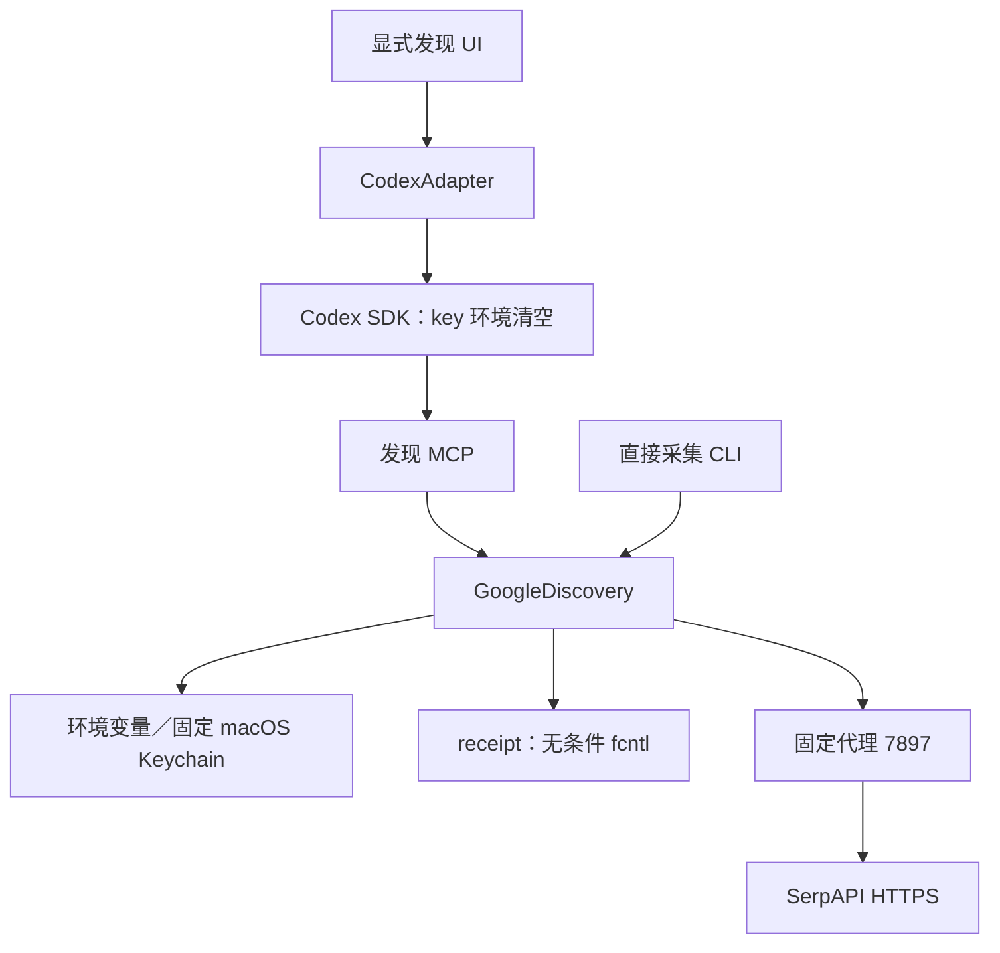
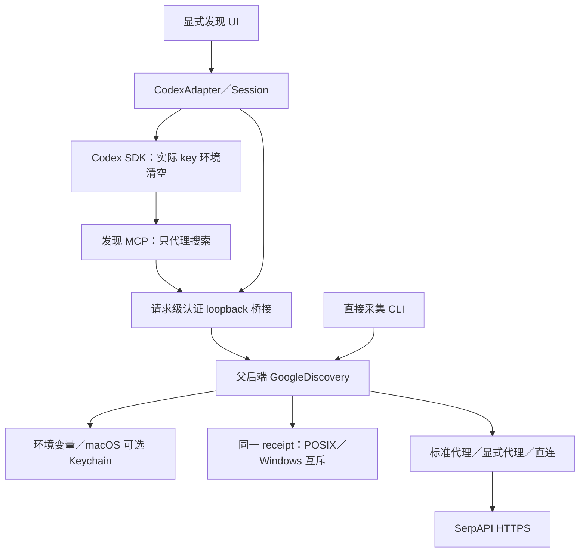
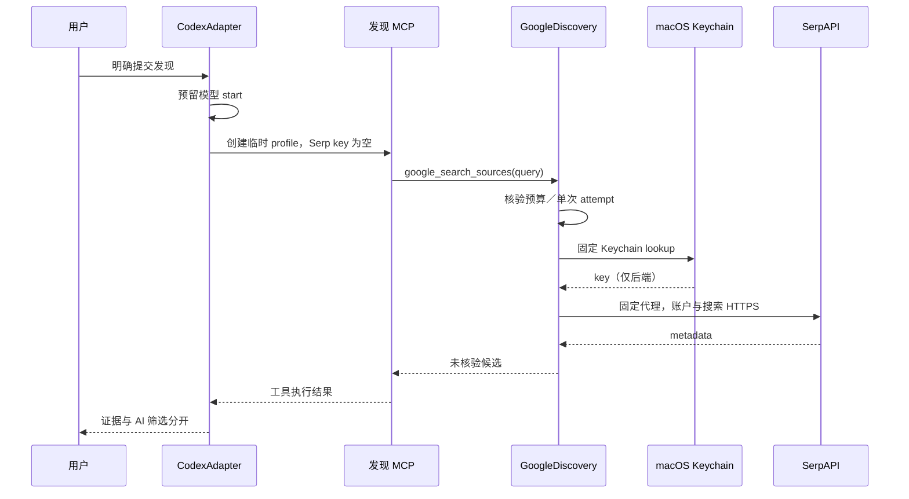
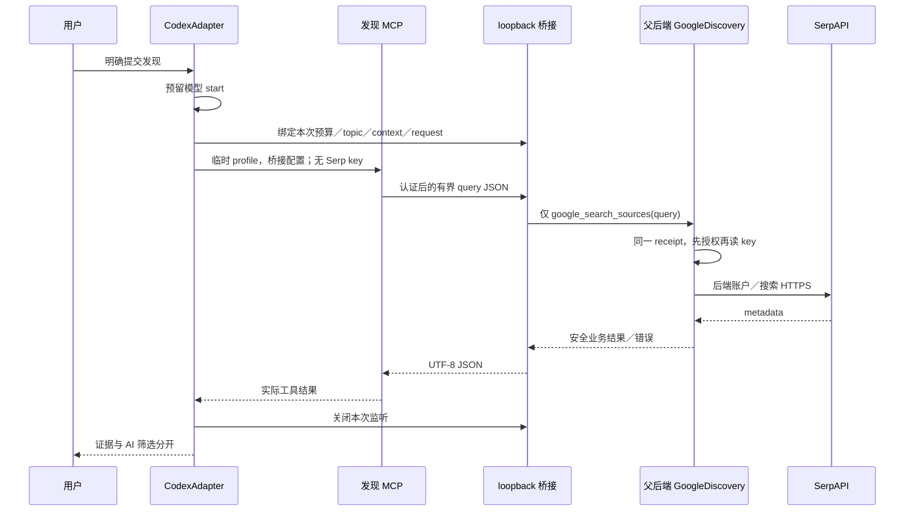
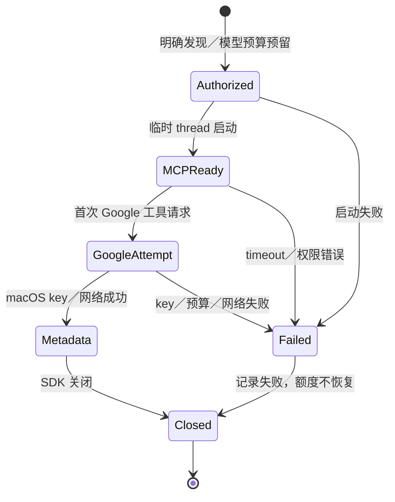
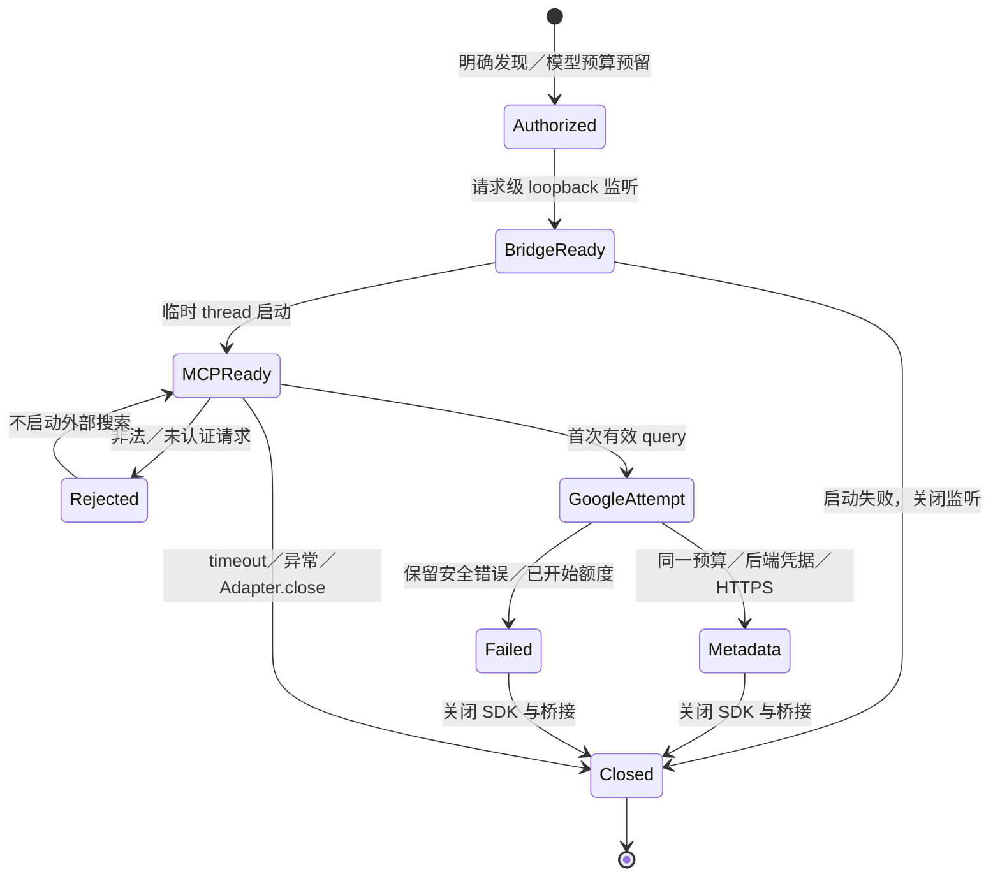
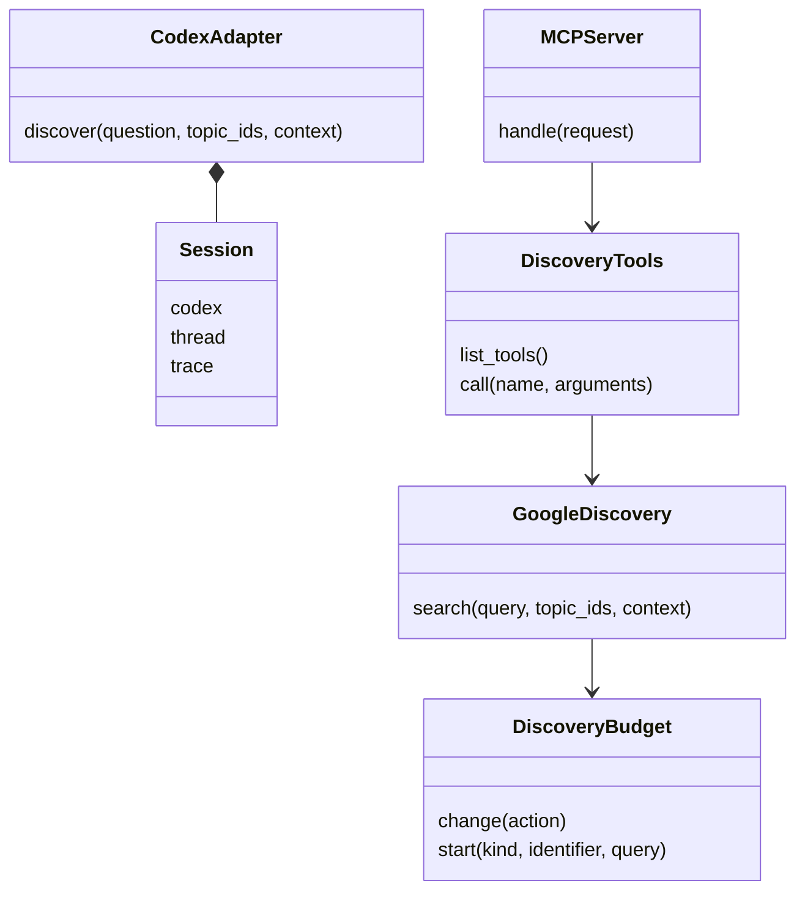
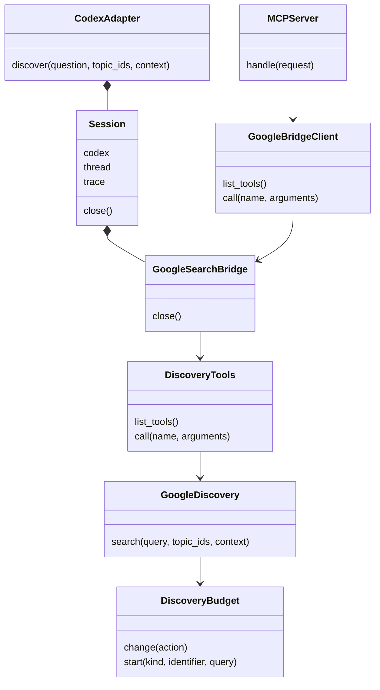

# 跨平台来源发现保留后端凭据与同一预算合同

用户明确要求 macOS、Linux 和原生 Windows 均可运行项目并补充测试。本次只适配运行环境，不新增搜索额度、付费调用、正式行情、发布权限或第二套模型运行时；已有未提交实现保留。当前验收仍须区分本机、平台模拟与实际 CI，不将架构图或 fixture 当作三系统产品通过。

## 决定与 Interface

- SerpAPI HTTPS 验证与本地凭据存储分开。直接 CLI 和应用父后端优先读取 `SERPAPI_API_KEY`；仅 macOS 可以复用原专用 Keychain 项，不自动发现其他个人凭据。其他系统缺 key 返回明确错误，不运行 macOS 命令。
- 应用父后端拥有 GoogleDiscovery、凭据读取、budget、topic、context 和 request ID。发现 MCP 通过一次发现请求专属的认证 loopback JSON 桥接调用搜索，不能请求 key、改预算、改 topic、打开任意 URL 或增加工具。实际 key 不进入 SDK 配置、MCP 环境／命令参数、模型、UI 或文件；普通市场六工具不使用此桥接。
- 桥接仅绑定 `127.0.0.1` 的动态端口，用短生命周期随机 capability 认证，只接受有大小限制的 `{query}`。它不是公开 HTTP Interface，也不暴露凭据读取操作。SDK 创建的 MCP 仅拿到桥接配置和本次受限调用权；代理／重定向禁用。重连仍受 receipt 中的单次 Google attempt 约束。
- `_Session` 拥有桥接生命周期：启动失败、timeout、完成、异常及 Adapter.close 均关闭监听。外部 HTTP 已开始的调用不因此恢复预算；不宣称可以撤回已发出的网络请求。
- DiscoveryBudget 隐藏 POSIX `fcntl` 与 Windows `msvcrt` 的文件锁差异，保持现有 receipt 字段、授权、start cap 和原子替换，JSON 明确使用 UTF-8。不以取消互斥实现 Windows 支持。
- Google HTTPS 使用标准代理环境；可显式设置 `LONDON_SERPAPI_PROXY`，空值表示直连。不再固定本机 `7897` 端口，不自动重试／重定向或更换 endpoint。
- 原 npm check 入口改由 Node 执行，统一选择 POSIX／Windows venv 的 Python，直接启动固定本地 CLI；保留 quick／focused／full 的 10／30／60 秒与退出余量，不需要 Bash，不改变覆盖或重试。Playwright 后端与 synthetic Market fixture 共用平台路径；JSON／工具 stdio 使用 UTF-8。
- 核验入口：真实 CLI/MCP 子进程、receipt 多进程竞争、真实本地桥接＋外部 fixture、SDK profile/lifecycle fixture、无认证的固定 Codex runtime 版本启动、macOS/Linux/Windows CI 与已有浏览器检查。实时 SerpAPI／模型调用不在本次执行授权内。

替代方案：把 key 放进 SDK 的 MCP env 会让 SDK 持有实际凭据；临时 key 文件增加持久化与清理义务；只在 MCP 读取 Keychain 无法适配非 macOS。选择请求级桥接，让凭据始终留在现有应用父后端内存中。它是内部 Adapter，不改变 `/api/discovery` 的请求／结果或业务工具合同。

## 架构／调用关系：当前

## 架构／调用关系：目标

## 时序：当前

## 时序：目标

## 状态：当前

## 状态：目标

## 类／职责：当前

## 类／职责：目标

