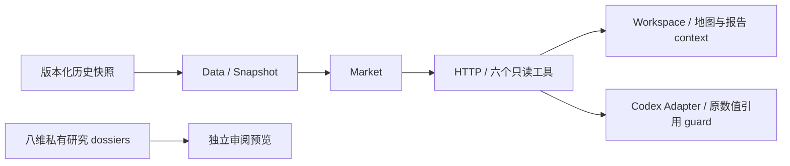
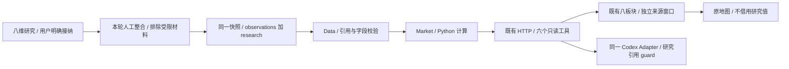
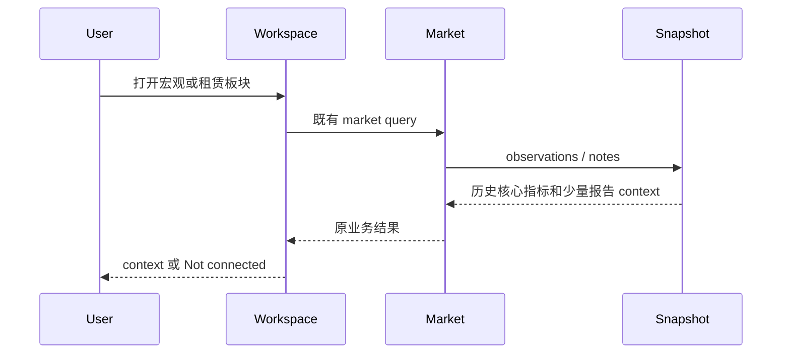
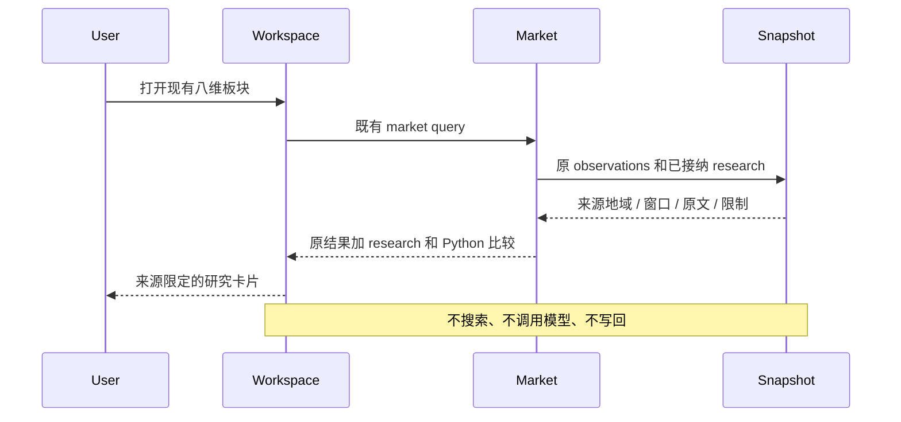
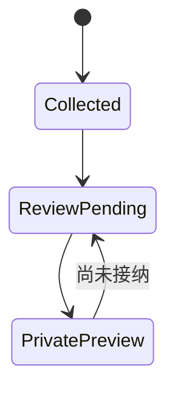
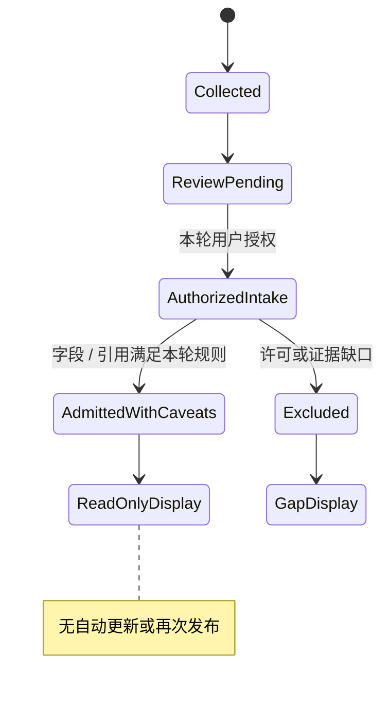
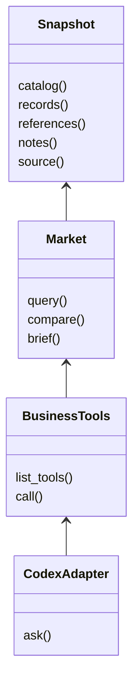
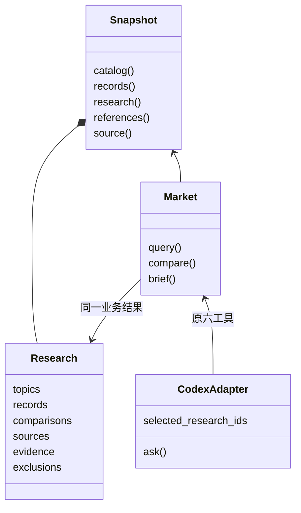

# 八维历史研究接入现有应用

2026-10-12 用户明确授权本轮八维研究入库并直接更新现有应用。复用 Data → Market → HTTP/六个只读工具 → Workspace 的既有 Module；不新增应用、数据库、依赖、工具名或搜索／模型调用。不设自动发布任务。

数据合同按加法扩展：原租金／空置 observation、四个示意选区与比较保持原状；快照新增 `research`，同时由 Market query/brief 返回。研究包含两期与其他明确窗口，**独立于地图选择和地图 YE 筛选**。真实年度流量、季度背景、存量、预测、UK/样本背景和事件分别表达。Source geography 不推导 area_id，forecast as_of 不借用发布日期。

许可受限与缺保存摘录的字段只入 exclusions，不发布对应数值或引文。Newsletter的HTTP文章参考不作为发布来源/日期；原始图转录保留定位和方法限制，不声称图像hash核验。普通模型可通过既有 `market_brief` 选取本轮工具返回的研究ID；数字仍来自Python，必须完整引用其来源。原 `verify_source` 的两份Savills文档网络范围不扩大。

## 架构／调用关系：当前

## 架构／调用关系：目标

## 时序：当前

## 时序：目标

## 状态：当前

## 状态：目标

## 类／Interface：当前

## 类／Interface：目标

不改变依赖方向：Data拥有证据与记录，Market拥有比较，Workspace只渲染，Adapter拥有模型引用与运行时。UI和模型均不重新解释发布策略或计算涨跌。最新验收在 `docs/verification.md`，图不替代测试。
