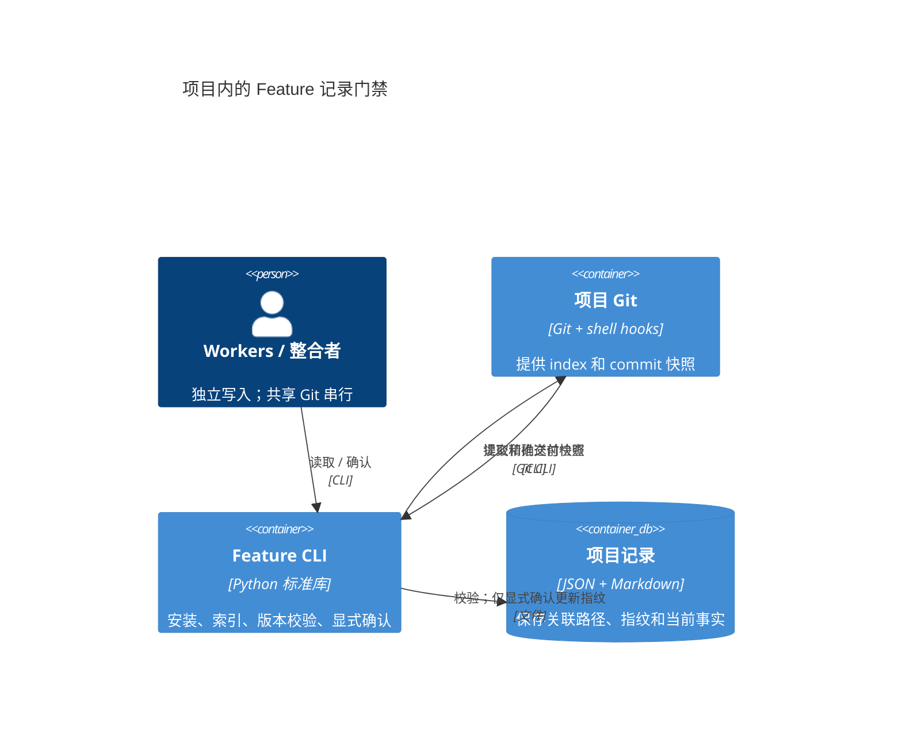

# Feature 记录的本地边界

当前：按能力维护独立的当前事实；Presentation 仅维护 Kimi prompt、真实截图与代码交付记录，PPT 制作／修改交给 Kimi，接入既有 Git 的提交／推送边界。受管范围以 `.feature-docs/run list` 为准，记录门禁不改变应用 API、地图或市场 Agent 权限。

- **Module / Interface**：单个自包含工具隐藏 Git、指纹与安装收据；项目入口为 `.feature-docs/run` 的 install/list/check/review。
- **Boundary / Contract**：记录只含 paths/fingerprint 与 Markdown 正文；项目拥有记录，通用 skills 同步不覆盖它们。Business Module 不依赖门禁。
- **Governance / test surface**：保留定制 hooks 与资产，范围仅显式追加；以真实 CLI/index/commit 检查验证，业务沿用原检查命令。当前纳管索引列出的能力实现／测试，不宣称保护全部项目。
- **并行契约**：同一 main / worktree 内，worker 的实际写入文件与记录页不相交，review 只解析指定页；共享 Git、完整测试与构建由单一整合者串行执行。paths 是引用而非写锁，提交仍检查完整 index / tip。
- **限制**：指纹只约束文件版本，不证明文字准确或产品验收；hooks 可绕过。地图 E2E、实时模型及既有未完成验收不因此转绿。
