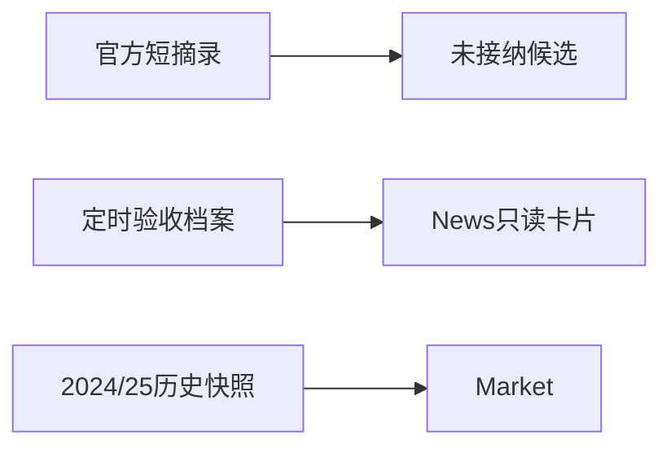
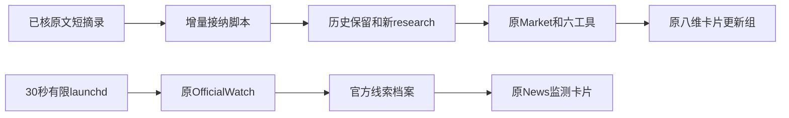
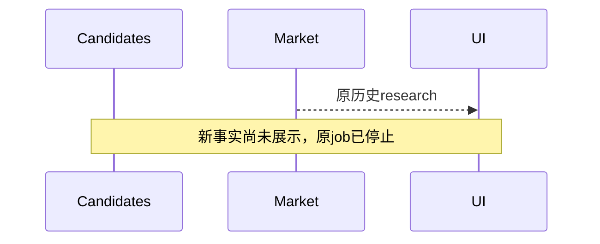
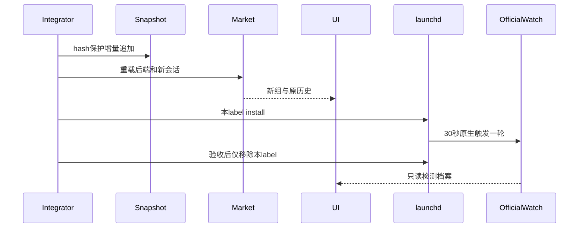
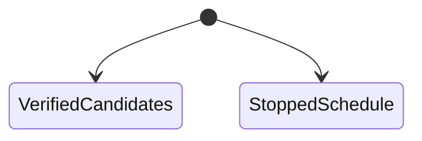
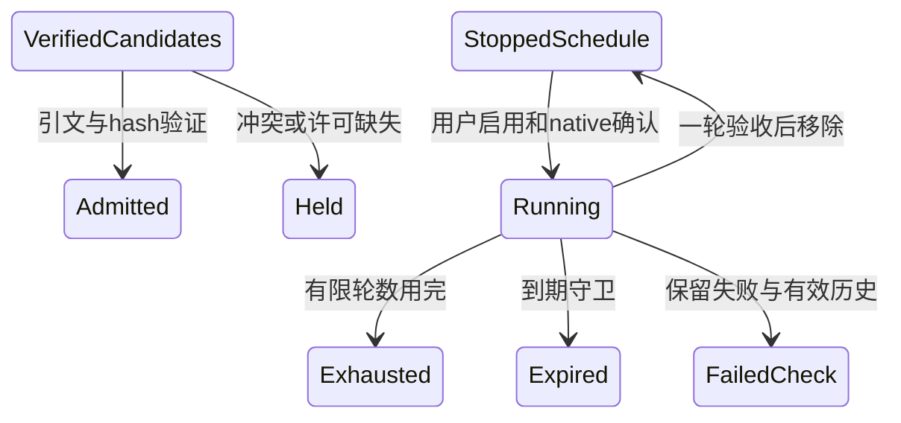
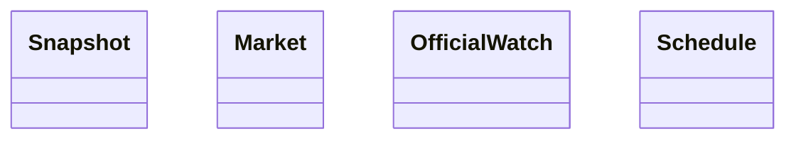
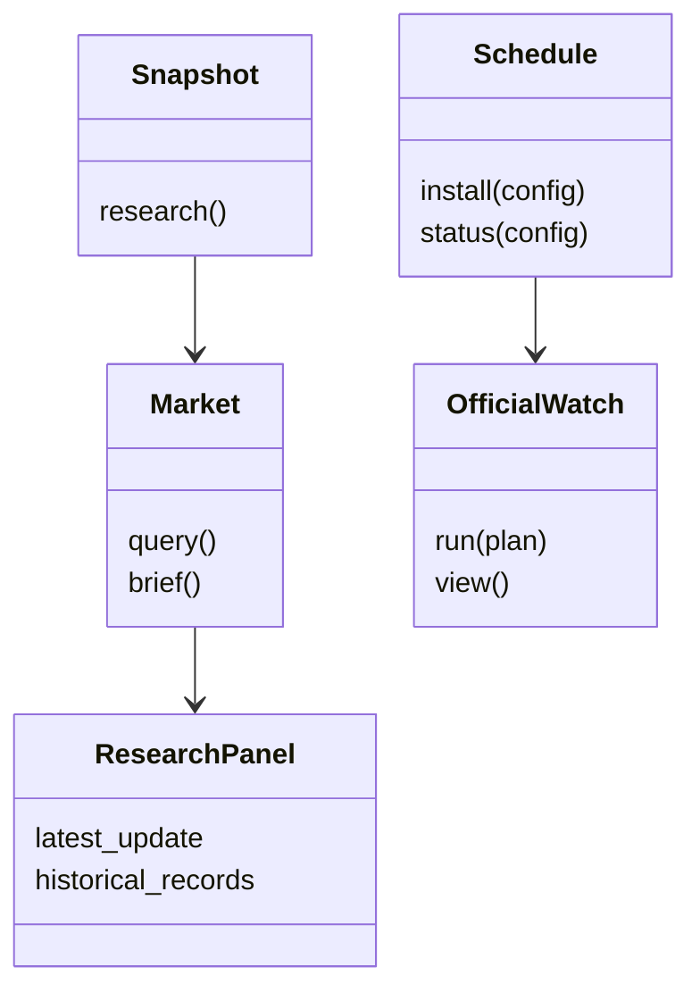

# 最新核验事实接纳与有界持续监控

用户2026-10-12明确要求把最新值入库和监控启用，而非停留在界面。本批次直接落实，父Agent整合；不建立Ticket、框架、依赖或付费通路。沿用原Snapshot／Market／六工具和官方检测＋launchd。

## 范围与合同

- 复用已存官方短摘录，无新原文抓取／Google／模型。4条UK背景：9月17日Bank Rate3.75%，July三个月GDP0.4%，May–July就业率75.1%、失业率4.9%；保留真实父文档与单独/latest佐证，不补造未知分母。
- Savills September2026版发布9月30日，实际月度August2026。接纳Grade A租金City86.26／West End134.17£/sq ft；Central London月度take-up557416、City373298、West End184118sq ft；Central London YTD6.13m；City Grade A承租面积占比95%；Professional Services月度面积占比31%。不称prime／headline，不补per annum，不把YTD当月度，不补YE地图。
- 增量更新只追加已核facts、对应sources/evidence；原120条records／来源／证据／比较／8事件／7排除全部保留，地图11观察及catalog periods不改，原source verify白名单不扩。两份不同日期或统计窗口不是冲突；真ID/口径/值冲突停止，不静默替换。
- research增加可选 `latest_update:{admitted_at,source_checked_at,record_ids,source_ids,note}`。仅指本次已核验接纳集合，不声称自动最新全市场覆盖。新资料原文；旧研究不必清空或翻译。
- 原八维卡片先显示相关latest_update记录，随后原历史研究；共用原record renderer，逐条范围／实际窗口／发布日期／引文。未更新维度仍明确历史，不伪造最新年份地图；页面顶栏仍标历史地图时期。
- 用户随后明确取消7天，要求10/20/30秒快速检查证明能力、优先及时更新资料。采用原Interface最小30秒、max_runs1、expires_at上海今日09:00；每轮两个索引共2次HTTP，现累计29/cap32不改，不新增／重置／复制／延期receipt，Google／模型预算也不变。5MB/20秒/无redirect或retry保持。
- 先install专用空run_dir，复制原已完成官方档案（仅source JSON，保留hash与来源manifest，非receipt或native starts）形成连续baseline，等待launchd自然StartInterval；不手动tick/kickstart。确认1轮后只remove本label，保留执行与来源记录，并让UI指向这个已验证配置。
- 仍是索引线索检测而非自动任意文章数值发布；此次最新12事实按用户授权明确增量接纳。未知／冲突／许可不足不发布。用户已不要求常驻，短运行证明功能存在可用而非永久服务；真实launchctl状态、HTTP与UI展示分别验证。

## 当前架构

## 目标架构

## 当前时序

## 目标时序

## 当前状态

## 目标状态

## 当前类

## 目标类

## 验收入口

最短公开Seam先RED：Market查询应出现12个确值新record而历史/地图/排除不变，UI真实HTTP的新组/来源/窗口；再对真实快照增量、重载API、原生状态、手动首检分别取证。此次30秒触发不借手动或旧OS触发证明，已实现原native能力的真实证据独立保留。离线、真实源HTTP、原生安装、应用UI、地图和模型分别报告，未运行不冒充。
