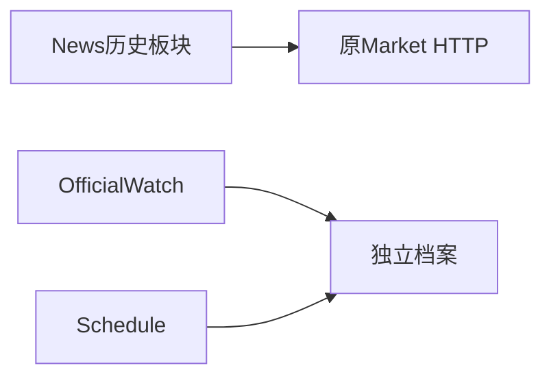
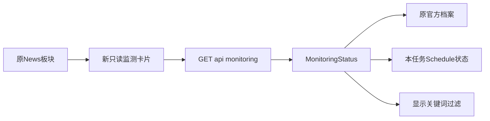
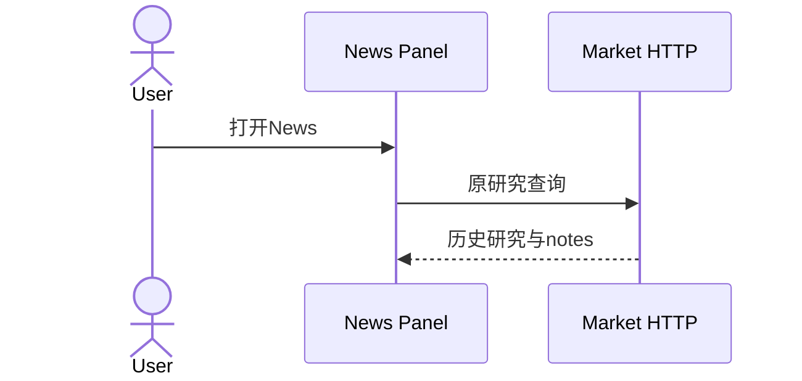
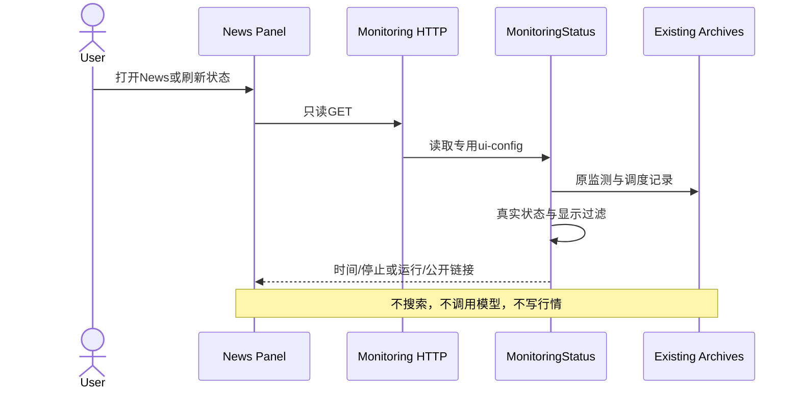
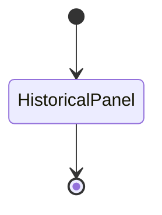
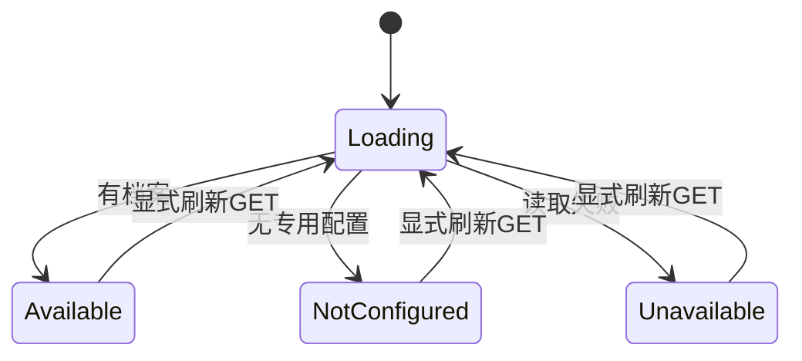
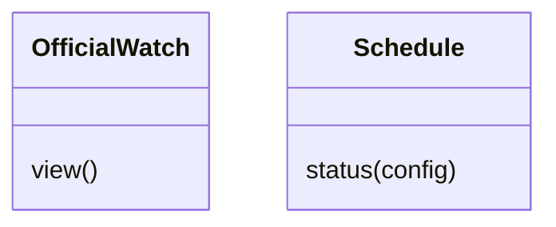
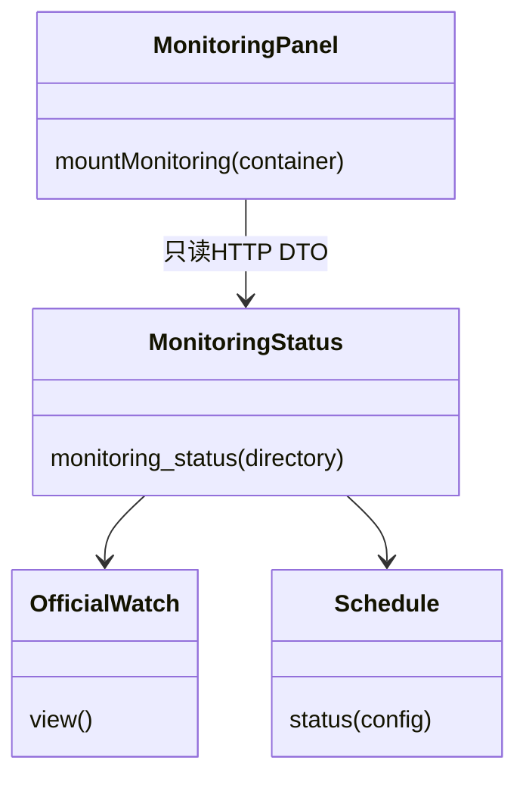

# 最小监测状态界面接入

2026-10-12 用户授权优先接上最小界面，快速推进。复用已有News板块、官方检测档案与原生定时状态；不新增页面、模型筛选、翻译、后台浏览器搜索或正式数值写入。父Agent为本票整合者；后端worker只写状态Module、app.py和独立新测试，前端worker只写新展示Module／样式／新测试，main.ts小接线由父Agent负责，其他并行改动保留。

## Interface

- `GET /api/monitoring` 无输入、只读。读ROOT/var/monitoring/ui-config.json（schema_version:1，schedule_config指向仓库内现有schedule JSON）；未配置时明确not_configured。
- `monitoring_status(directory)` 返回schema_version:1、data_kind:monitoring_status、status、last_checked_at、schedule、filter、sources、formal_market_updated:false、warnings。status为available／not_configured／unavailable。
- schedule仅state（running/stopped/exhausted/expired/unknown/unsupported/not_configured）、interval_seconds、max_runs、run_starts、remaining_runs、expires_at；本机原生状态需真实Schedule.status，不能根据plist或历史记录冒充正在运行。其他OS明确不支持。
- sources条目仅id、label、status、checked_at、index_url、new_link_count、links。每个link含url/title/edition/published_at/observation_period/is_new。保留未知日期和源文版次／统计窗口的区别。不返回本地路径、预算receipt、native_print、认证／账户字段。
- 简单过滤仅对显示的公开链接：精确官方HTTPS host和明确办公CRE词，排除job/career/recruit/hiring词；不把一般vacancy词当招聘，不删除源档案。Savills月报匹配既有系列；Crown新闻以London/office/West End/St James/Hanover/Spring Gardens/Piccadilly/Haymarket/Regent Street/commercial property/workplace等标题／URL关键词匹配。filter含mode:official_office_keywords、ai_used:false、omitted_links。这是粗筛，不是AI判断或行情核验。
- 只读可以调用受限Schedule.status读取本任务launchctl label，但不能install/tick/remove、联网、使用模型或更新正式快照。失败不显示成无消息／零值，latest failure保留上次有效链接和检查时间。
- 新前端Module `mountMonitoring(container)` 在现有News板块插入状态／来源卡片，提供Refresh status按钮（只GET）。源标题原语言，新增轻量UI英语，不改已有语言字典、地图年末period、研究数字或Model调用。必须保留2024/2025地图历史说明，不声称2026-YE已可得。

## 当前架构

## 目标架构

## 当前时序

## 目标时序

## 当前状态

## 目标状态

## 当前类

## 目标类

## 验收

离线验证无配置／实际档案／停止／失败／显示过滤、无被动外部操作；前端类型检查与真实HTTP融合的News板块浏览器验收。fixture只保护显示行为，不替代真实API。已有两次真实launchd检查在capability/live-native，不重新伪造定时或消耗过期授权。当前测试job已经移除，应显示stopped或exhausted而非running。正式快照仍历史，本任务不把索引或snippet装成最新市场值。
