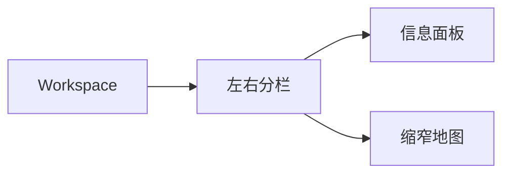
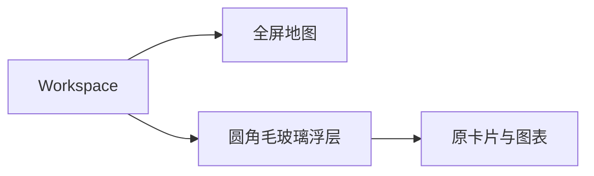
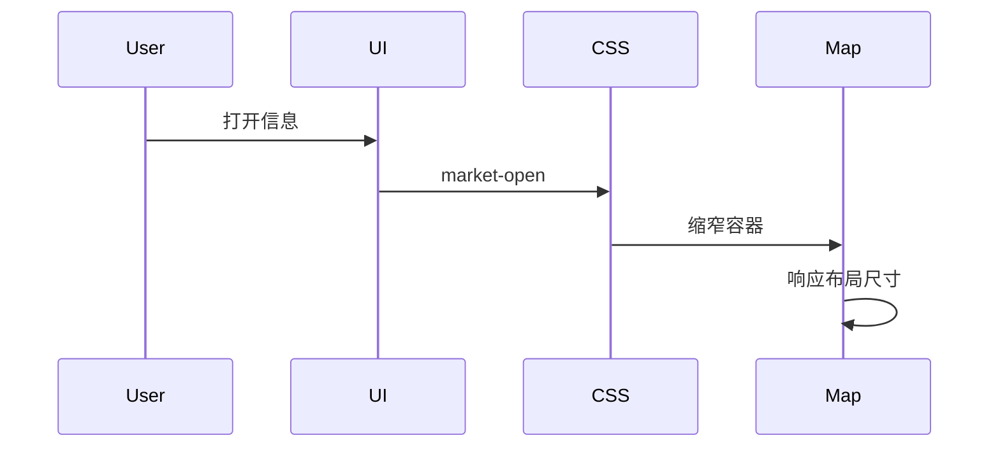
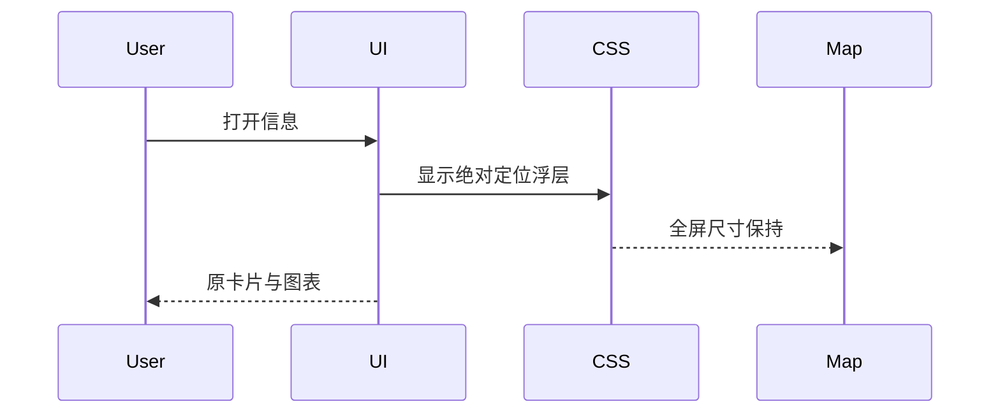
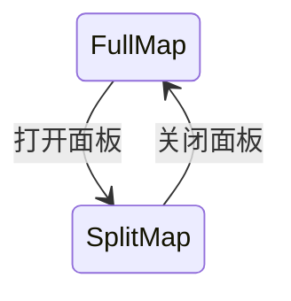
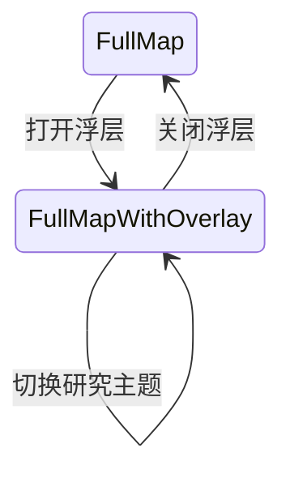
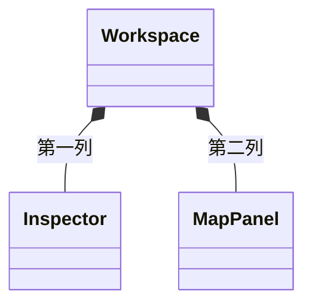
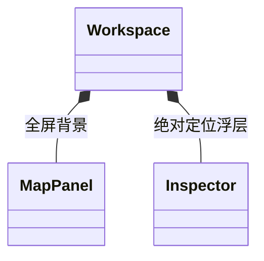

# 研究仪表盘视觉优化

用户2026-10-12要求图表、2026研究覆盖提示、毛玻璃圆角，并进一步明确：地图始终全屏，左侧信息悬浮在地图之上，不是深色分栏。固定点e4bcc97；仅前端呈现，不扩展数据、HTTP、MCP、权限、调度或依赖，不打包。

- 地图容器始终覆盖整个workspace；打开、关闭或切换信息浮层不改变地图尺寸和镜头。桌面左侧圆角半透明浮层，移动端使用地图上的底部浮层；浮层内部滚动，不截断引用。系统降低透明度偏好可采用实色。
- 参考Apache ECharts横向bar和doughnut视觉；不安装ECharts、CDN或字体。SVG/CSS消费原Python值和display_value，前端只计算绘图几何，不发布新市场值、同比、合计或剩余份额。
- 只取latest_update显式集合、有source/evidence绑定的available有限值。租金及月度take-up分别要求同版、单位、窗口、共同来源；City Grade A和Central London Professional Services各自独立环图，必须匹配已捕获面积分母。unknown/null/不匹配分母不画环。月度与YTD不混合，UK宏观分别为独立KPI。
- 图中保留单位、地域、窗口、发布日期和来源；完整原卡片、引文、URL与7排除保持。缺失不是零，无合适记录不画图。
- 右上角独立显示已核验研究2026与历史地图2024–2025；研究年来自显式已接纳记录release_vintage，不是系统年份。无集合退回Historical evidence；三语badge本地切换不请求网络。新图说明保留原英语。

## 布局修正：当前／目标

用户明确改变布局要求后，Mermaid Gate记录局部状态和关系，业务及公开接口均不变。

### 当前架构

### 目标架构

### 当前时序

### 目标时序

### 当前状态

### 目标状态

### 当前结构

### 目标结构

## 验证

沿用quick≤10秒、focused≤30秒。真实HTTP/production UI检查1600px与390px打开浮层前后地图边界相同、圆角/透明/blur及无横向溢出，图中源值/URL与原卡片共存、无被动POST；unknown分母使用合成变异回归，不能当作真实市场证据。完整地图性能与实时模型未重跑，不沿用历史GREEN冒充新验收；不请求官方来源、搜索、模型，不续期授权。
