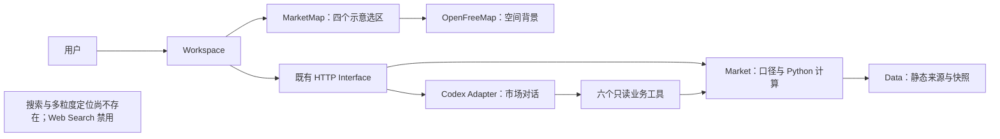
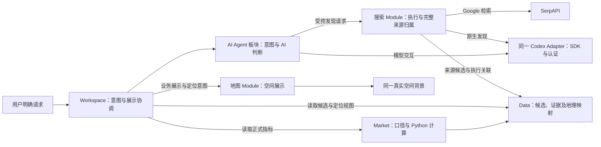
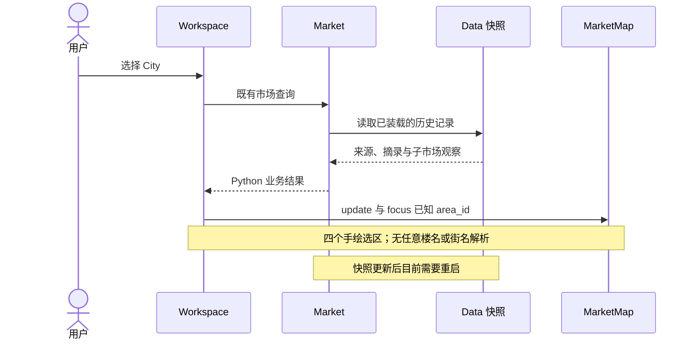
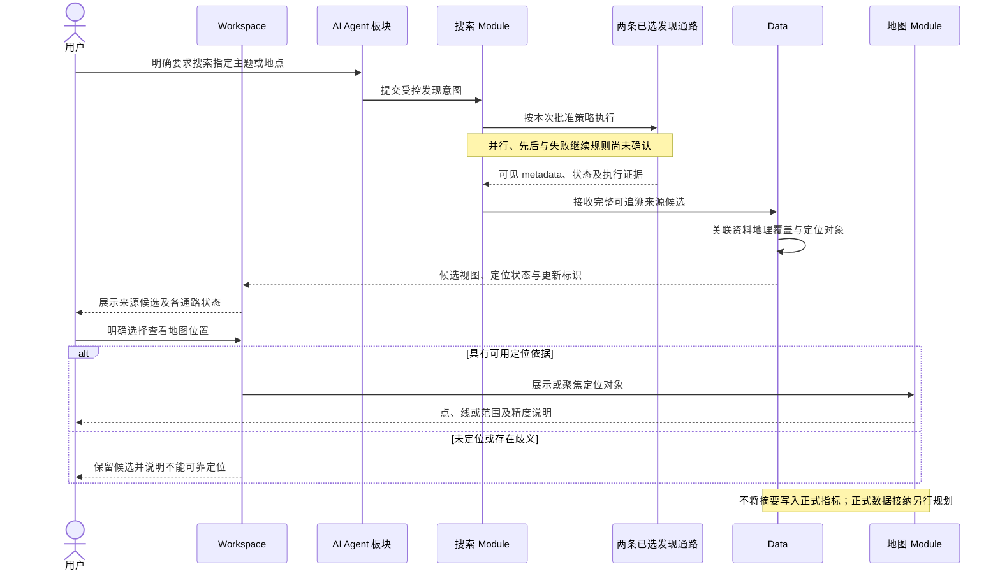
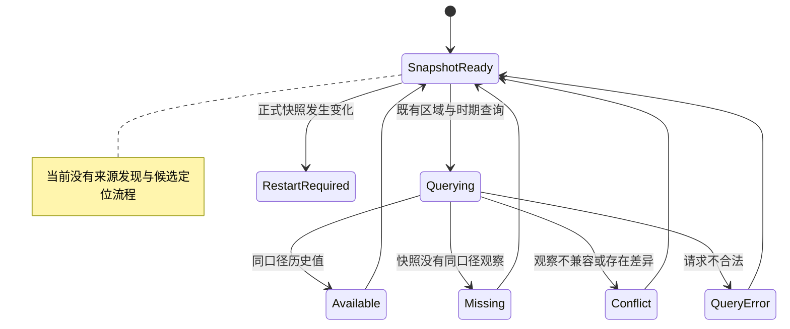
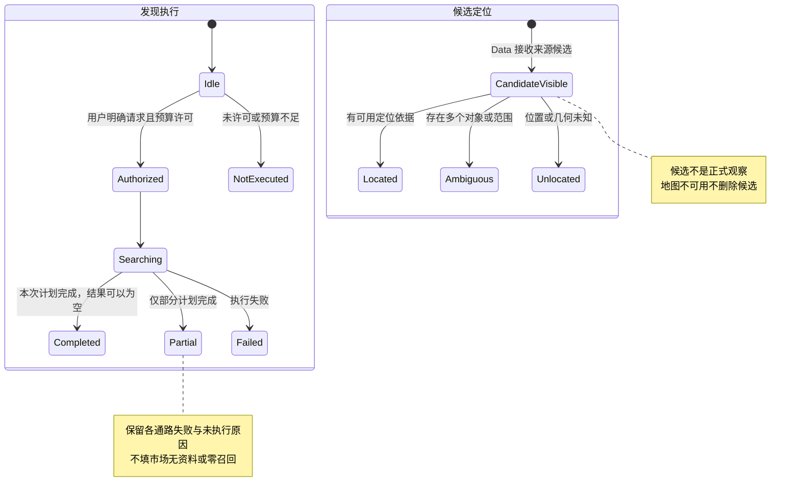
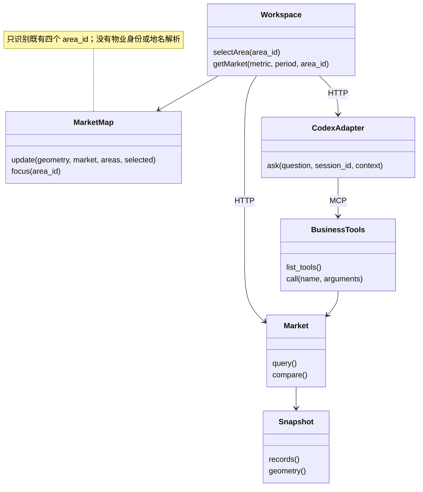
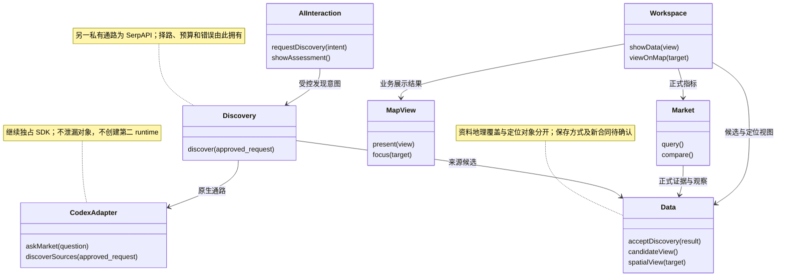
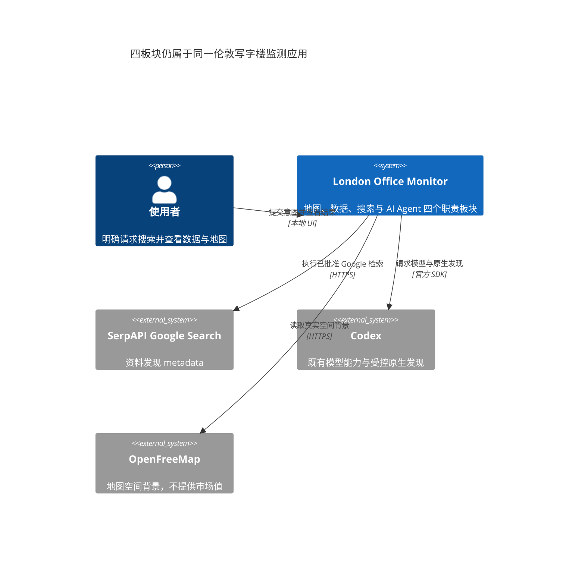
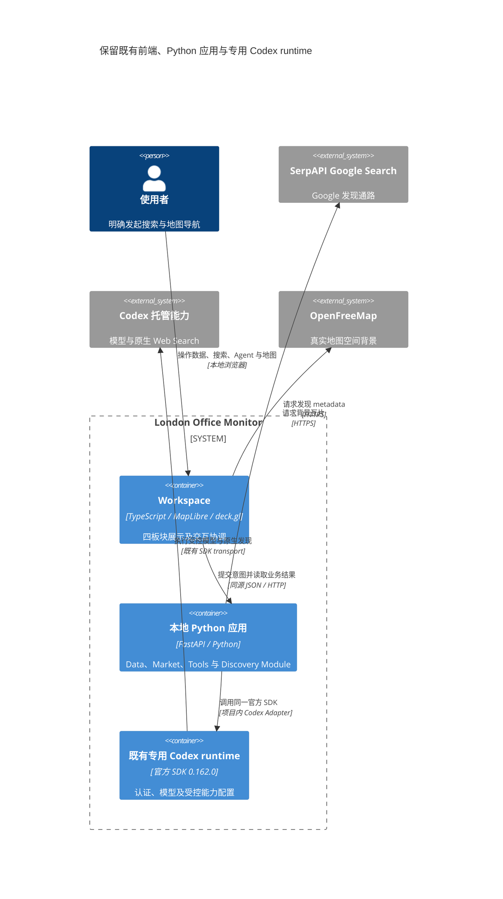

# 地图、数据、搜索与 AI Agent：四板块架构澄清

**状态：完整四板块／空间目标仍是规划草案；来源发现子切片已另行获准小步实施。** 用户明确不走新 Spec、Tickets 或 Ralph，先完善来源与 AI 双通路，地图映射、街道／区域精度与板块划分后置。现行来源合同和实现边界见 [合同](../contracts.md)、[Feature](../features/source-discovery.md)。下文十张图中的“当前”保留 `0177481d73f4b0ba57c74049a634f75cf3c1cb8c` 架构基线，目标图不是完整已实现能力；不拿旧图替代最新产品验收。

依据：[术语表](../../GLOSSARY.md)、[ADR 0001](../adr/0001-evidence-and-runtime-seams.md)、[ADR 0002](../adr/0002-four-capabilities-and-spatial-mapping.md)、[现有合同](../contracts.md)。保护既有 WIP；地图本阶段已按用户认可收口，软件渲染余项暂缓，不自动恢复 #5。

## 明早测评交付：先做最小展示

测评必交是可运行、可交互的 Python AI Agent PoC，以及 3–6 页业务演示；允许自行定义精确范围，地图不是必交要求。用户现已要求优先展示效果，暂缓复杂定位与架构扩展。

- 复用现有地图、九个业务导航和独立 Agent，不重做 UI，也不把四职责变成四个新页面或进程。
- 以“历史租金／空置率查询、Python 比较与来源追溯”及“明确请求后的新资料发现候选”两条业务故事组织展示。用户已批准本批 SerpAPI 最多 8 次搜索 HTTP 启动、Codex 最多 3 轮启动（2 轮原生发现＋1 轮主项目交互验证）；共用新收据，失败／超时也占启动预算，不重开旧 lab 收据。摘要、历史值和新资料候选分别标注，不靠假数值补齐业务兴趣清单。
- 本次沿用四个已有子市场上下文。楼名点定位只保留单例取证作为可选加分项，不是必交或当前来源实施的阻塞；不保证任意楼名命中。街区解析、精确楼栋轮廓、权威范围替换、数据库、正式数据动态接纳及发布策略后置。候选展示不因这些能力停住，也不硬把全伦敦资料归到 City。
- 复用现有五页演示文稿及生成入口，收尾更新实际截图、范围、限制和最新验证状态；历史 replay 不当作实时模型实测。

下文四板块与多粒度定位图保留为后续目标，**不是明早交付的实施清单**。本次按用户新授权实现独立 JSON 来源候选池、显式 HTTP／Tools 发现及同一 CodexAdapter 的隔离 profile，使用 Feature 微文档和门禁；不发布 Spec、不拆 Tickets、不启动 Ralph。正式行情更新、数据库／地图精确关联及超出本批上限的真实调用仍须另行确认。预算收据在 `var/runs/minimal-demo-authorized-discovery-budget.json`；SDK 轮启动封顶不冒充内部 HTTP、查询覆盖或硬费用封顶。

## 现在能做什么

- **City 不是 London 全城。** 它是当前 Savills 历史报告使用的伦敦金融城办公子市场名称；不是已经核实的行政区边界。其他机构的 City 口径也不能仅凭同名自动合并。
- 四个地图范围都是手绘导航选择区。它们能用于点击、聚焦和选区着色，**不能证明报告覆盖、行政界线或统计范围正确**。Midtown / Fringe 也没有已核验的统一范围。
- 地图目前只按四个 `area_id` 聚焦。没有任意地址／楼名／街名解析、物业身份目录或街区边界解析。底图有真实建筑足迹，不代表能将资料正确绑定到某一物业；内部建筑 part ID 不是物业 ID。
- 正式数据是 JSON／GeoJSON 快照，不是数据库或实时订阅。更新后目前需要重启应用；前端有市场查询缓存，Codex Adapter 拒绝继续使用已发生变化的启动快照。
- 普通市场 Agent 仍只有六个只读工具、Web Search disabled；明确来源发现通过同一 CodexAdapter 的临时 profile 调用 Google 工具与 native live search。主项目真实一轮双通路已通过，不能扩大成全文核验／正式行情或地图关联能力。

### 楼名定位的单例可行性取证（不是产品验收）

2026-10-11 对 `One Canada Square London` 执行 1 次 SerpAPI Google Search：HTTP 200／metadata Success，取得名称、地址和 Wikipedia 来源关联，完整保留 27 条 URL 出现记录；没有结构化 GPS 返回，不把 Google 地图中心或链接 ID 解码成楼栋位置。该次客户端耗时约 1.81 秒，不能外推为搜索 SLA 或通用定位耗时。

随后读取所发现的公开 Wikipedia 页面，其坐标短摘录由 Python 解析为参考定位点；这说明该真实例子有可追溯位置，不证明任意楼名解析能力或物业边界已核验。不同返回块的相关性也未整体核验。证据在 `artifacts/discovery/20261011T103755Z-minimal-demo/point-feasibility.json`，未复制完整商业报告、未修改正式数据或地图。

该定位单例消耗 Google 首次启动；随后六题来源采集及真实应用 Google 调用使用同一 receipt，本批现为 Google 8／8、Codex 2／3（native discovery 1＋普通市场验证 1）。真实双通路已在 UI → Python HTTP → Codex → Google／native 路径通过，完整池保存 187 个不同 URL 字符串、247 次出现，含 URL 变体及偏题资料，不是已核验市场覆盖。原生可见 metadata 捕获 30 次 URL 出现，短引用绑定 thread／turn／item；AI 筛选与全池分开。普通市场真实 compare_periods 也已通过，未泄漏发现工具。证据见 `artifacts/discovery/20261011-source-first/`。地图定位 E2E、资料全文／最新指标核验仍未执行；Google 额度已用完，现场新增搜索须获新预算，不重开旧收据。

## 四板块的知识归属

四板块指业务职责和相互独立的可观察状态，不要求拆成四个进程、四个数据库或四个新的顶层 UI 页面。

| 板块 | 拥有的知识／行为 | 不承担的行为 |
|---|---|---|
| 地图 | 空间背景、点／线／面展示、定位意图、相机与渲染生命周期 | 不搜索资料、不判断来源统计口径、不重算市场指标、不发布观察 |
| 数据 | Data 拥有来源／证据／候选、资料地理覆盖和定位关联；Market 拥有定义、查询、Python 比较、missing／conflict | 不拥有搜索 provider、SDK 事件或地图渲染知识 |
| 搜索 | 一个深 Discovery Module 拥有已批准请求的执行、SerpAPI Google Search 与 Codex 原生 Web Search 的择路／融合、预算、完整返回候选及失败证据 | 不改正式快照、不推定全文获取／AI-use 许可、不将摘要变成市场事实 |
| AI Agent | 理解明确请求、提出查询意图、在授权范围内执行搜索、给出单独标注的 AI Assessment | 不直接取得 shell／任意网络／多 Agent 权限，不持有搜索 key，不绕过数据接纳规则 |

HTTP 与 Tools 继续传递业务对象，不另建一份数据或统计逻辑。Codex Adapter 仍独占 SDK、认证、线程和事件转换；原生搜索通过其受控发现能力接入，不全局打开现有市场对话的 Web Search。搜索执行策略不泄漏给地图或普通数据查询调用方；具体能力配置和工具权限需后续合同确认。

Workspace 只协调用户输入、选中对象和各板块结果，不承担 provider 编排或在多个视图中重复解释资料地理覆盖。新能力不引入研究框架、通用插件、第二 runtime、数据库或消息总线。

## 如何映射：地理对象不等于统计范围

目标是允许一条资料关联一个或多个定位对象，而不是把所有结果塞入现有四个选区。关联知识由 Data 集中拥有，地图、数据列表和 Agent 使用同一份业务结果及引用；不各自按名称或坐标重新匹配。

| 资料实际覆盖 | 可用的地图表达（目标，非现有承诺） | 数据约束 |
|---|---|---|
| 全伦敦／Central London | 有可靠范围时展示范围；只有概略位置时明确标注，不画猜测轮廓 | 不改写为 City，也不把全城指标分摊到子市场 |
| 机构定义的办公子市场 | 保留机构覆盖名称；权威边界、示意选区和定位点分别标注 | 同名不同机构不自动变成同口径序列 |
| 某条街道 | 有可靠位置／线形时定位；只有地址文本则保留待定位 | 该街道的消息不等于附近所有楼的行情 |
| 街区／园区／社区 | 根据来源所指对象和可靠几何定位，不猜测类别或边界 | 不默认等同于行政区或报告子市场 |
| 某栋楼 | 有可核对的物业身份及位置时定位到点；只有可靠足迹时才展示轮廓 | 子市场指标不变成该楼指标，底图 part ID 不作物业 ID |

来源候选保留原始 URL、查询、通路与执行关联。资料地理覆盖、定位对象、定位依据／精度、歧义与未定位状态分别表达；AI 建议的关联仍是 AI Assessment，不自动成为已核验关联。地点有歧义、坐标／边界未知或无法证明同一对象时，候选仍可查看，但不得用模型猜测补齐。

“未定位”“搜索失败”“未执行”“正式指标 missing”不是同一种状态。定位成功也不保证已取得、获准使用或核验了对应市场数据。

## 更新、失败与定位问题的诊断

- **即时候选更新（已确认意图）**：明确搜索完成后，Data 接收可追溯来源候选；数据列表及可关联的地图详情显示新资料。未定位候选留在列表，不靠虚构坐标上图。
- **正式指标更新（独立后续通路）**：获准获取 → 核验／形成 Research Candidate → 按尚未确定的 Publication Policy 接纳 → 正式市场视图。AI Assessment、Research Candidate 与 Published Observation 分别保留，不预设自动发布或一律人工审批。
- **无重启刷新（目标，合同待确认）**：Data 提供一致的数据版本；候选变化和正式数据变化分别表达。Workspace 在获知更新后重新读取对应视图，失效相关缓存；地图更新内容但保留相机，不重建 3D 背景。先复用既有 HTTP，不预选 WebSocket、推送框架或调度器。
- **时间语义**：发现时间、原文发布日期、观察／报告时期、核验时间和展示版本不同。新找到旧报告不是新发生的市场变化。“即时”展示的具体时限仍待确认，不能承诺外部信息一发布便自动获知。
- **独立降级**：地图故障仍可读数据与搜索结果；搜索故障不清空已有数据；模型故障不伪造搜索或市场回答；候选接纳／定位失败保留已取得的发现证据，不冒充市场无资料。一个通路失败是否继续另一通路由待确认的择路策略决定。
- **可定位问题在哪一层**：执行记录能区分 provider 未返回、Adapter 丢失、融合去重、AI 未选、地理未匹配、Data 未接纳、视图版本未刷新及地图不可用。不无声截取前 N 条；展示分页／AI 选择不删除已返回候选。保留 URL 出现记录及去重关联，不把未核实的 canonical／镜像自动合并。
- SerpAPI 原 JSON 与 Codex 可见 typed metadata／事件各按实际证据层级保留；native 引用绑定本次执行、thread／turn、tool item 和 URL，不全局只存短 ref。不可见的底层 HTTP／费用／缓存情况保留未知，不能补成零。业务结果不含 SDK 对象或凭据。

“方便定位问题”不等于让应用 AI 自动修改代码或运维系统；这些仍属于编码 Agent 的另行授权任务。

## Mermaid Gate 与当前／目标图

**需要图**：目标涉及发现 Interface、跨 Module 调用及候选／定位生命周期。以下八图覆盖当前／目标架构、时序、状态和类图；另附两张 C4 总览解释同一应用的系统关系及部署形状。图中方法是职责示意，不是已经批准或实现的新合同；类图中的 Workspace / AIInteraction 表示逻辑 Module，不要求新增 class。

### 架构／调用关系：当前

### 架构／调用关系：目标

### 时序：当前

### 时序：目标

### 状态：当前

### 状态：目标

### 类图：当前

### 类图：目标

### C4 系统总览：目标

### C4 应用形状：目标

正式数据仍使用既有文件；本次候选采用独立 JSON／JSONL archive，完整保存与筛选分开，不借容器图增加数据库。图中待决注释保留原规划语境，现行小切片以 Feature／合同为准。四板块不是四个独立部署进程；同一进程内的职责隔离也不宣称进程级故障隔离。

## 验证建议与未决问题

**主业务 Seam：已有真实应用 UI，经同一 Python HTTP。** 当前来源子切片已覆盖“明确请求 → Google／native → 独立候选全池与 AI 筛选 → 界面”，保护正式指标不被摘要覆盖；离线仅在远程 provider／SDK Adapter 的私有 I/O Seam 替换依赖，实时轮不替换。Data 精确地理关联与明确地图定位是后续路径，不新增只供测试使用的生产定位 setter。

离线合同／业务测试、真实双通路发现与融合、实时模型、真实地图／E2E 四类验收分别报告。当前地图既有 RED 不被规划图或 lab guard 改写；复用现有检查入口与 10／30／60 秒预算，真实联网发现另行明确调用和等待预算，不把 50–65 秒的响应头等待塞入无模型完整回归或复制旧 45 秒超时。

原架构文档轮完成八张当前／目标图与两张 C4 总览的 GitHub Mermaid renderer 实际解析／完整 SVG 渲染，没有新增依赖。启动、缺 chunk 与中途 SVG 误判全部保留在 `artifacts/architecture/20261011T090440Z-four-panels/`，最终渲染为 `mermaid-current-docs.json`；本次文字同步不改十图源，不冒充再次渲染或产品验收。最新实现轮有42项离线、35项真实硬件浏览器完整检查，以及收尾安全补丁前真实发现与普通市场模型各一轮；补丁后未绕过额度追加live，通过细节见 [验证记录](../verification.md)。软件地图整套闭环仍按用户决定暂缓，历史RED不改写。

当前小切片不再被候选保存、显式 UI／HTTP、工具权限或旧 Spec 澄清阻塞：这些已获准并实施。已选择短查询、每次至多一次 Google 尝试与可观察原生边界，SDK timeout 保留失败、不重试；关闭面板不取消已提交请求。预算／专用后端 key／实际完成状态在现行合同表达，不声称硬费用封顶。后续只按任务需要决定：原始内容与口径核验、获准接纳及 Publication Policy、精确地理与定位对象、正式数据刷新时限、非 macOS key 部署方式；不扩大本轮为自动发布或全文使用授权。

用户明确本次使用 Feature 微文档和门禁，不等待 `$to-spec-lqy`、不拆 Tickets、不启动 Ralph；保持 main／无新 worktree。这份架构文档记录完整目标与基线，不是第二套 tracker 或待执行 backlog。
