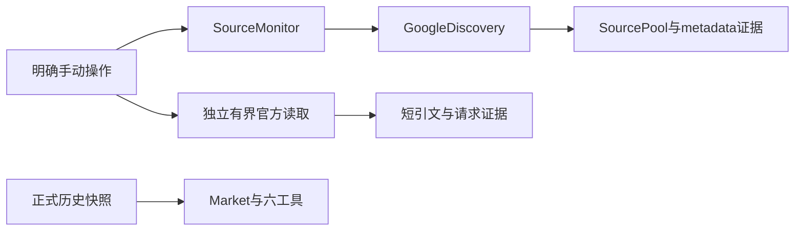
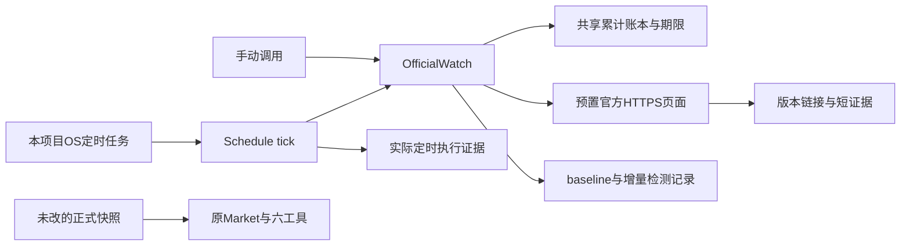
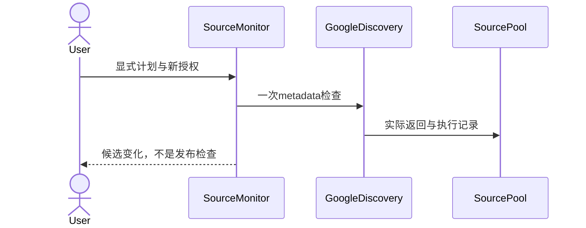
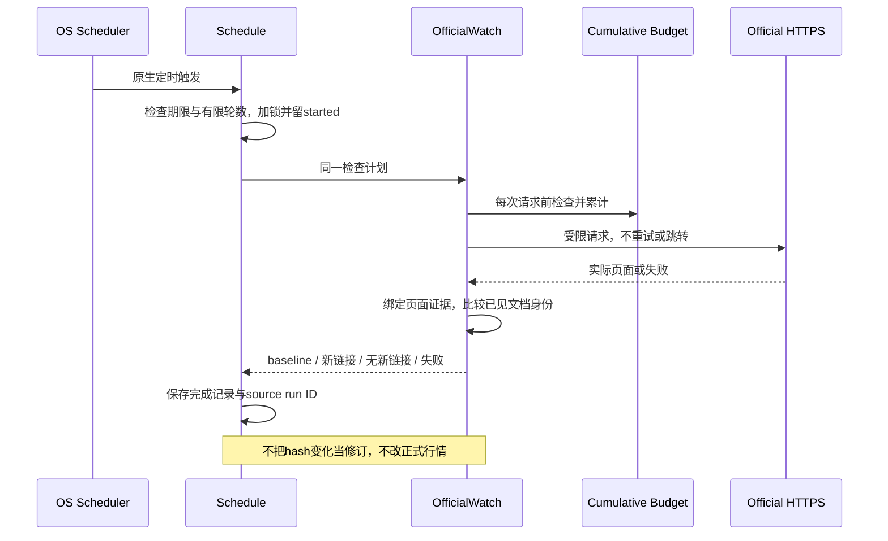
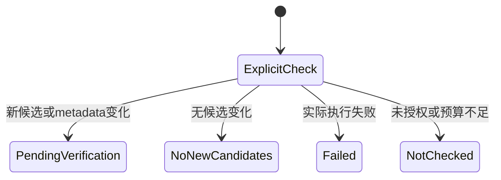
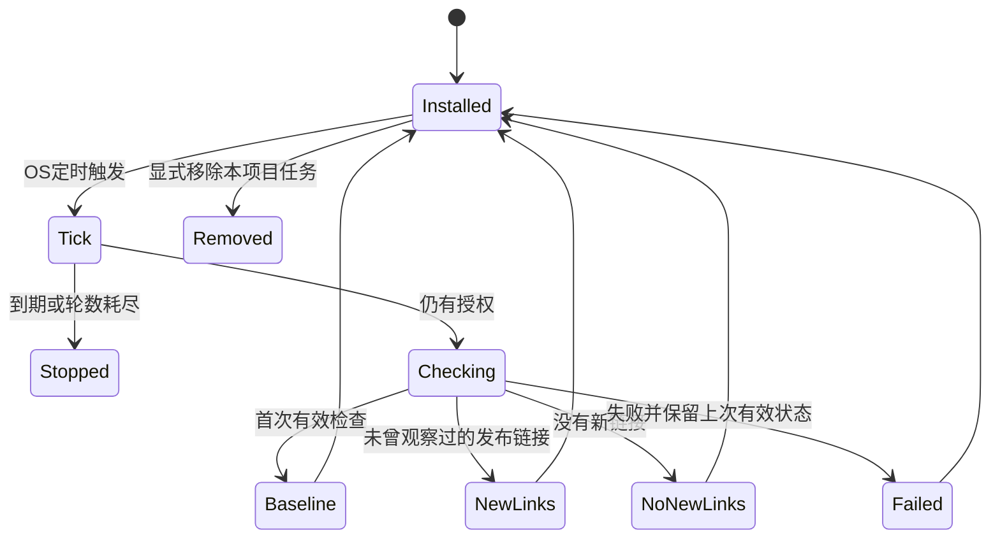
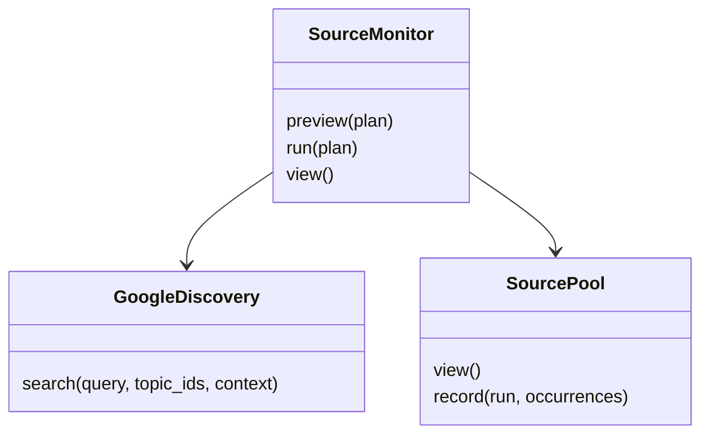
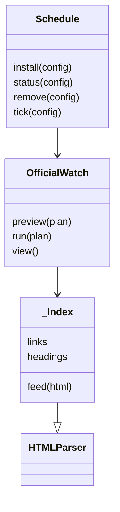

# 有界来源监测与真实定时触发

## 当前任务和权限

2026-10-12 用户优先补齐实时来源检测与真实定时触发，资料数量后补；应用 AI 筛选和自动翻译暂不实施。复用原应用、标准库及 OS 调度，不引入数据库、队列、模型、付费调用或调度框架。编码 subagent 只负责不相交的新文件，由父 Agent 统一整合和执行真实调度。

已有 `SourceMonitor` 继续负责一次 Google metadata 检查；它不保证最新发布或正式行情更新。本轮 Google 使用10/40（租金3，其余各1）、应用模型0。官方读取账本累计29，操作者保守上限32、每响应最多5MB、上海2026-10-12 09:00到期；用户允许重复官方读取，旧计数保留。账本原授权文字属于早期记录，后续修订和用户最新决定为准，不借旧 receipt 或自动续期。

## 最小新增 Interface

- `OfficialWatch(directory, budget_file).preview(plan) / run(plan) / view()`，包内 CLI `python -m london_office.official_watch`。
- v1计划仅选择已实现的 `watch_ids`；目标为预置、用户允许的官方 HTTPS 页面，不接受任意网址、跳转或源码指令。第一轮先验收 Savills Central London 月报索引与 Crown Estate 官方新闻索引，其他预置来源不代表已实测。
- 每次实际 HTTP 启动前持有原 receipt 文件锁并检查累计上限／到期；不自动重试，保留失败和上次有效状态。原文只保留必要短引文／链接／时间／响应hash，不存或再分发完整报告。
- 从实际官方页面解析标题、文档链接与明确的版次；发布时间未建立时保持未知。第一轮建立baseline，后续以已观察过的链接／明确文档身份做增量。hash变化、列表重排、URL重现不算新发布或市场修订；公告链接也不是新市场事件。
- `Schedule.install/status/remove/tick(config)` 与 `python -m london_office.monitor_schedule --config CONFIG --install|--status|--remove|--tick` 负责原生动作；使用macOS launchd，在仓库专用目录保存plist与证据，不写个人配置或其他项目。其他OS明确unsupported，不假称已原生验收。
- schedule v1含仓库内plan、budget、run_dir路径、interval_seconds、max_runs和带时区expires_at。每轮调用同一OfficialWatch动作，跨进程锁避免重叠，累计启动次数／到期共同限额。测试不调用真实网络；真实安装、OS触发和官方请求由父 Agent 串行验收。
- 通用v1 Interface接受interval_seconds>=30和正整数max_runs，但这不授予新的调用权限；本轮实际验收配置为60秒、2轮，并绑定不可改的安装指纹。到期／重叠／耗尽在来源动作开始前skip，无待退款的HTTP或来源轮；已开始的失败／中断仍计数。OS可以继续调用守卫，任务显式remove，不假称自动bootout或获准永久运行。

正式快照、Market、HTTP/MCP六工具、前端、CodexAdapter及verify_source原两份Savills白名单不改。新发布线索仍有来源范围和不确定性，不据索引直接写入数值行情。用户已允许合格事实默认接纳、冲突另决，但本轮优先交付监测能力，正式接纳进度单独报告。七项既有许可／证据排除保留。

## 架构／调用关系：当前

## 架构／调用关系：目标

## 时序：当前

## 时序：目标

## 状态：当前

## 状态：目标

## 类／Interface：当前

## 类／Interface：目标

## 验收与停止边界

最低证据分别为：离线 Interface 测试、真实官方页面检查、launchd安装／触发／移除记录及由OS触发的source run ID。手动tick、sleep后手动执行、fixture、历史地图GREEN不能代替真实调度。本轮不消耗应用模型额度，不声称AI筛选、完整八维覆盖、市场实时数值流或其他OS调度已实测。真实map/E2E与模型验收仍单列。

独立旧切片的10项测试及双轴accepted只证明SourceMonitor，不代替新增能力验收。新增watcher15项／scheduler13项通过，完整离线Python106项通过。真实launchd两轮在上海06:36:17／06:37:20完成、间隔63.083秒、每轮两个索引HTTP200，首轮baseline、次轮无新链接；真实观察到exhausted skip，随后仅移除本测试label。正式快照未写，应用模型0。证据为 `artifacts/monitoring/20261012-capability/live-native/verification.json` 和完整安装／状态／移除记录；原证据仍在readiness目录，冻结包不覆盖。

Standards新独立审阅accepted；Spec审阅原findings与父整合者合同澄清保留，原reviewer被harness清理导致resume失败，未启动替代，独立Spec Closure未完成，Clean gate未运行。功能与真实触发证据不代替这一缺口。长期启用／到期后预算、正式事实接纳、实时模型／地图E2E仍分别报告。
