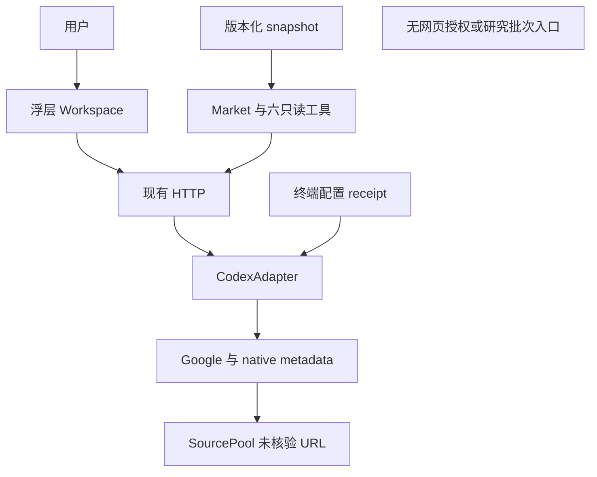
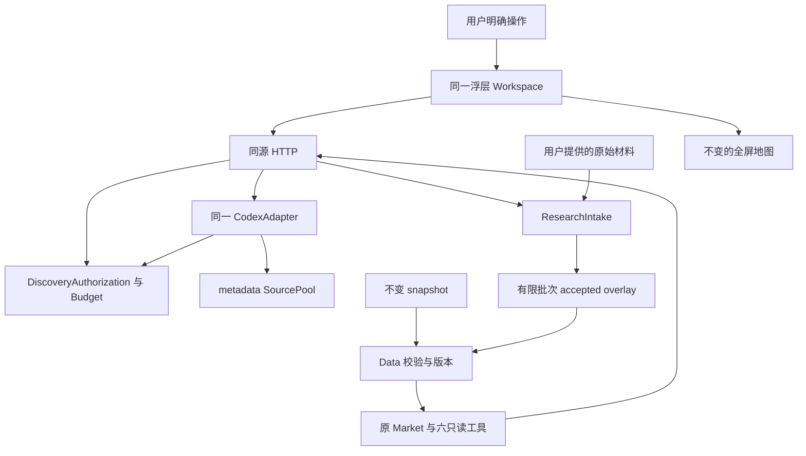
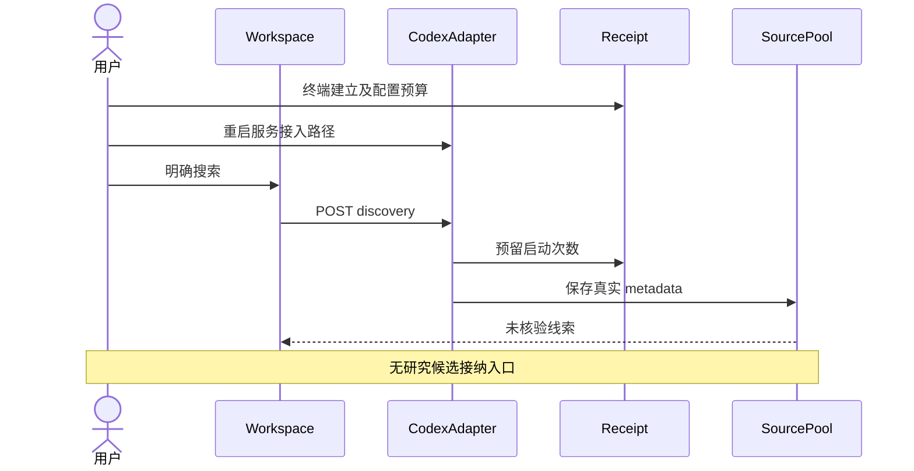
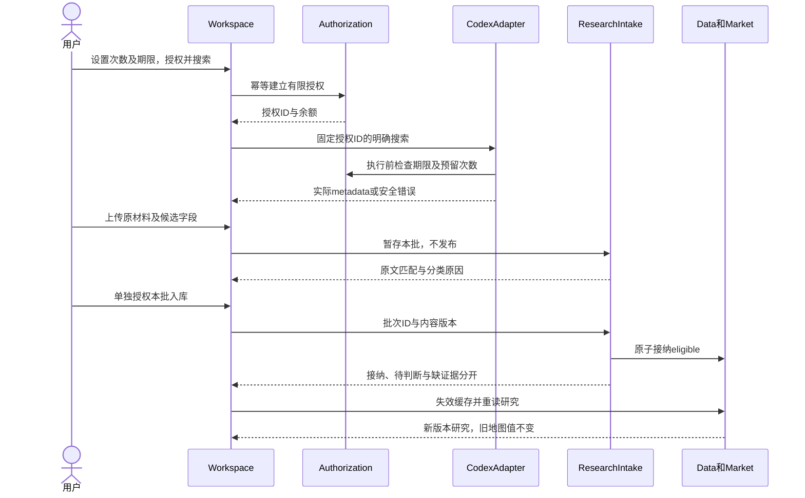
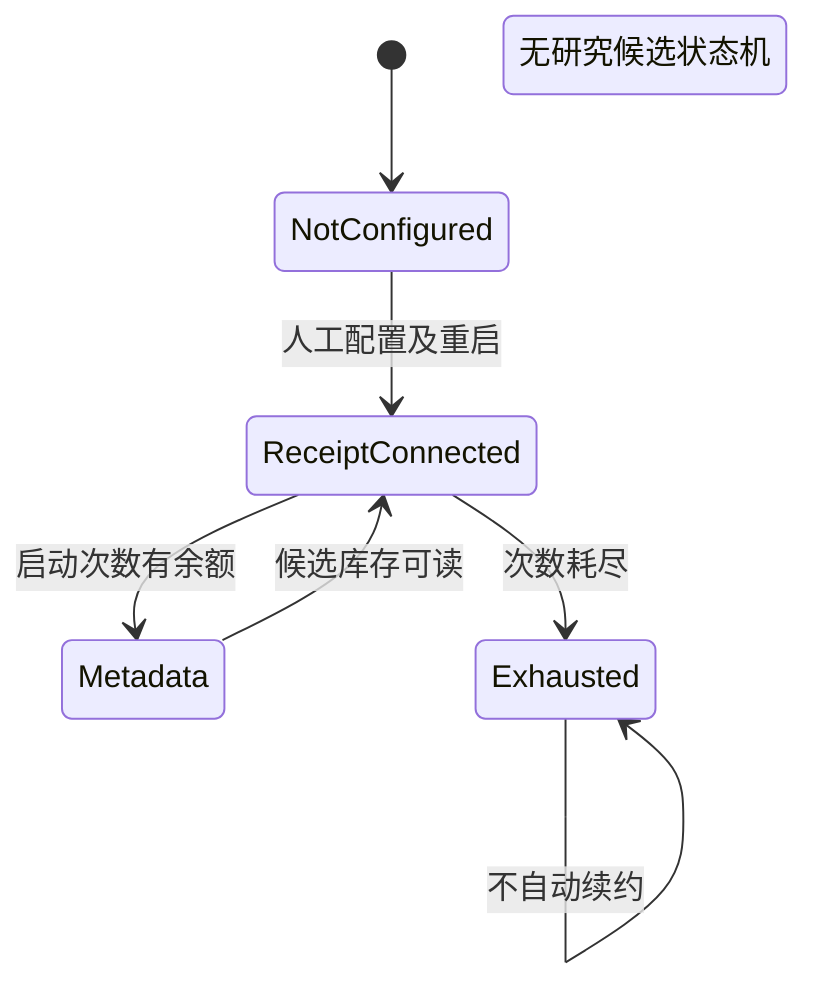
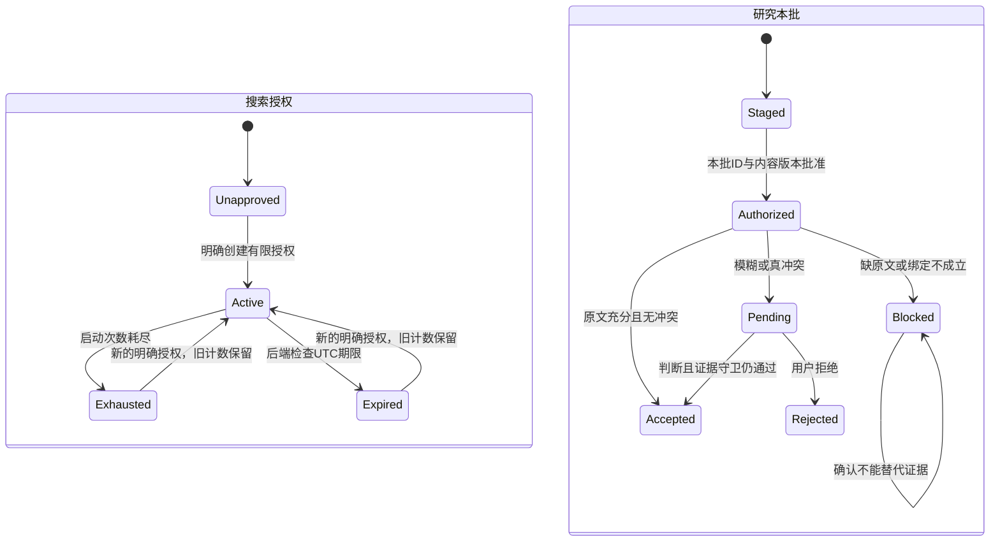
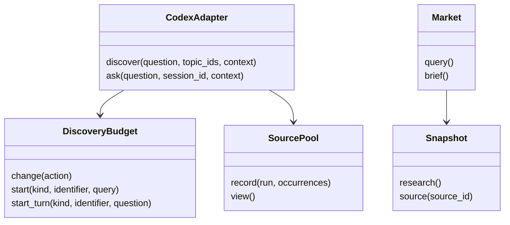
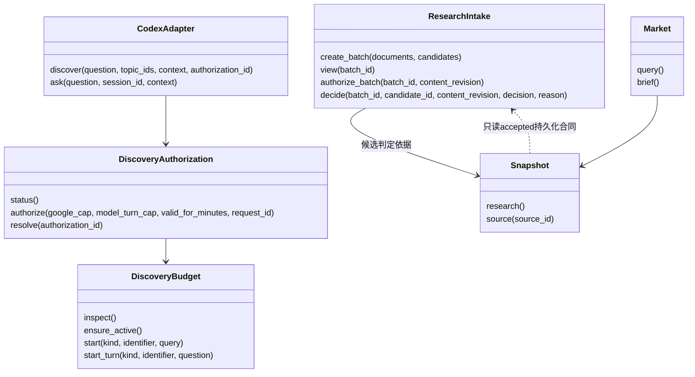

# 网页有限授权与本批研究接纳

用户已确认本轮 Interface、独立 JSON 持久化与有限本批接纳设计。此页是实施设计，不是产品验收声明；原始材料上传不证明在线机构认证，搜索 metadata 永远不是原文证据。不新增抓取、依赖、数据库、队列、模型工具、自动续约或无限发布。

## Module 与合同

- DiscoveryAuthorization 拥有网页额度创建、活动授权选择与只读状态；DiscoveryBudget 继续拥有跨进程锁、启动计数及原子替换。每次发现固定到一个 receipt，Google 桥接不能中途换额度。
- GET `/api/discovery/authorization` 只读状态（不查账号/凭据），POST 同路径输入 `{google_cap,model_turn_cap,valid_for_minutes,request_id}`。有限正整数，上限分别 100、100、1440；request_id 是同一次明确用户操作的幂等标识，重放不清零。新 receipt 的普通市场问答 cap 为零。已有 `LONDON_DISCOVERY_BUDGET_FILE` 作为未配置网页授权时的原入口保留，不覆盖旧 receipt。
- POST `/api/discovery` 加法接收 `authorization_id`。新授权状态含 id、authorized_at、expires_at、已开始/上限/剩余 Google 与 caller turns；legacy 未注明期限如实显示，不虚构到期日。有效期由后端 UTC 时间计算，Google 账户/搜索启动与模型执行前都检查；已发出的请求可以完成，过期不妨碍完成证据保存，不退回额度。
- ResearchIntake 拥有原材料捕获、字段绑定、候选分类、有限批准及接纳账本。GET `/api/research/batches` 与 GET `/api/research/batches/{id}` 只读；POST `/api/research/batches` 只暂存；POST `/api/research/batches/{id}/authorize` 输入 `{content_revision}`；POST `/api/research/batches/{id}/decisions` 输入 `{content_revision,candidate_id,decision,reason}`，decision 为 accept/reject，仅已授权的本批候选可处理。
- 暂存 JSON 为 documents + candidates。document 是 `{id,filename,content_base64,url,publisher,title,published_at,usage_note}`；只处理用户上传 PDF/HTML/TXT，每文件及整批原 bytes 合计≤5,000,000，按内容 hash 保存到 ignored 专用目录，不接受客户端文件路径或核验标志。candidate 是 `{id,document_id,topic_ids,kind,metric,label,value,unit,source_geography,statistical_window,definition,denominator,billing_period,release_vintage,quote,context_quote,section,value_anchor}`。本切片处理有限 scalar reported values；预测章节／原材料相邻数值句／context 不可被裁掉后伪装 actual，不假造 forecast/event 提取能力。quote/context_quote 是有界原文定位，value_anchor 位于 quote 中。原文缺失/不匹配/数值不支持的候选不能靠 accept 放行。未知或不能确定的单位/字段绑定不能自动接纳。
- 同口径身份包括 metric、kind、地域、统计窗口、definition、unit、denominator、billing_period；release vintage 与修订另保留，不自动覆盖旧版。同身份不同数值为真冲突；不同窗口/单位不是同口径冲突。可疑定义差异或多值绑定需判断。相同事实标为 duplicate，不新增一条正式数值。真冲突人工接纳时保留各报告值与冲突标签，不择一个无提示的共同值、不自动计算比较。
- 批次内容不可追加/替换，授权绑定 content_revision；改变候选需新批授权。明确批准后 eligible 自动接纳，needs_confirmation 等待用户，blocked 保留缺口。重放批准/决定不重复写入。
- `var/discovery/authorizations/` 保留网页授权及活动索引；`var/research/documents/` 保留用户原材料，`var/research/state.json` 原子保存批次、决定与 accepted overlay。所有运行数据不提交/打包。State 的 accepted 为 `{records,sources,evidence}`，revision 为单调数据版本。Data 合并且验证 overlay，Market 与六工具通过原 Interface 读取；版本化 snapshot、地图 observations 与 geometry 不写入。
- 新写入口必须来自精确本机同源 JSON 用户操作；不注册为 MCP 工具。普通六工具仍只读。Workspace 接纳后失效市场缓存并重读研究，保留镜头/选区/浮层。旧模型回答保留历史；研究版本变化后的旧会话要求下一次明确提问重新开始，不自动调用模型；若执行中版本改变，该轮不接受混合版本回答。

## 验证 Seam

按公开 Budget/Authorization、ResearchIntake、实际 localhost HTTP 与现有 Playwright 入口逐行为 RED/GREEN。覆盖有效期（包括预留后执行前到期）、耗尽、竞争、幂等、旧 receipt 不变、metadata/伪核验拒绝、缺原文无法确认、模糊/真冲突与不同窗口、只读工具、无重启刷新及桌面/手机地图尺寸不变。远程 provider/SDK 仅在其 I/O Seam 使用 fixture；真实业务 HTTP/存储不 mock。分开报告离线、实际本机 API/界面、真实地图融合与实时模型；本次实时搜索/模型/读取未授权，不执行。

## 架构／调用关系：当前

## 架构／调用关系：目标

## 时序：当前

## 时序：目标

## 状态：当前

## 状态：目标

## 类／Interface：当前

## 类／Interface：目标

