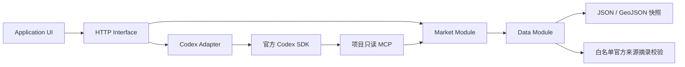
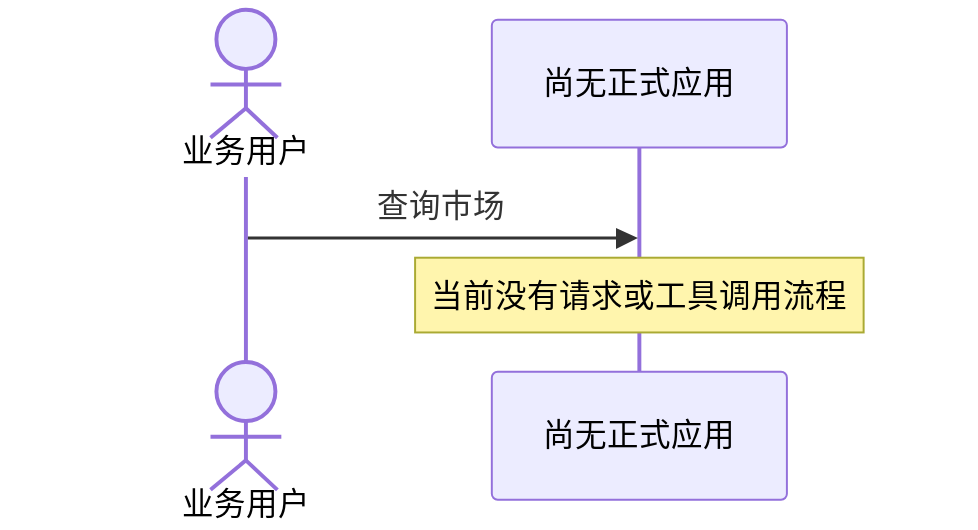
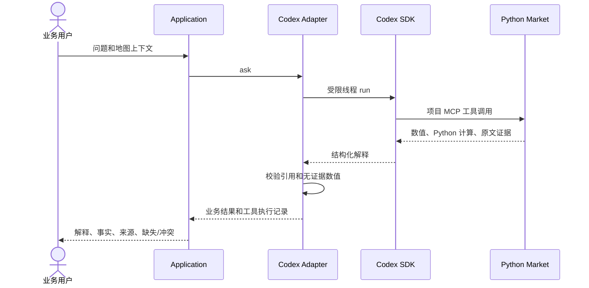
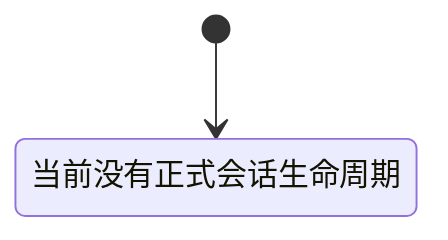
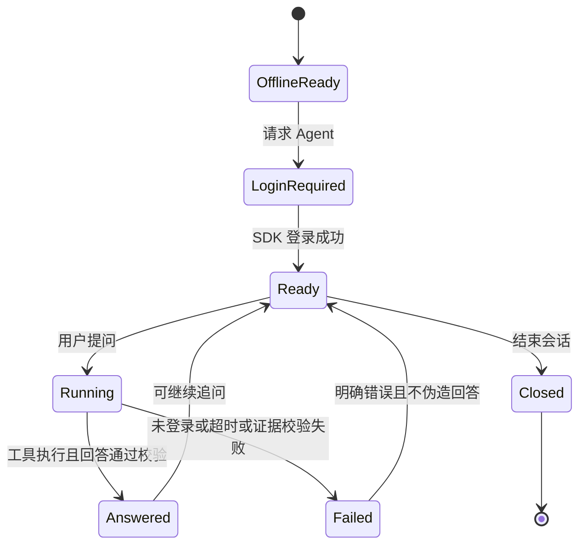
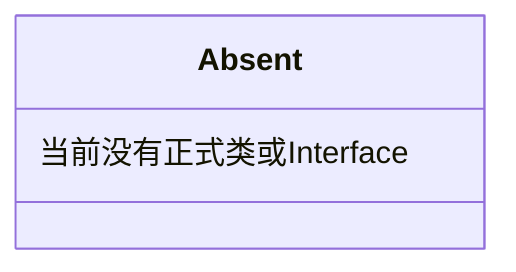
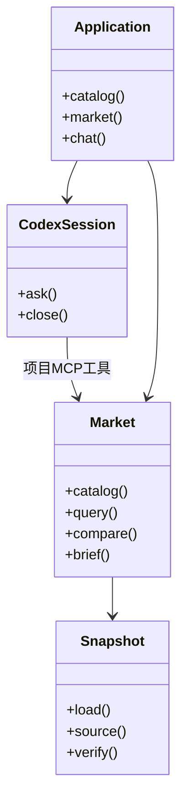

# 交付可运行的伦敦写字楼监测 PoC

## 已确认范围

Python Agent PoC 和 5 页英文业务演示文稿是必交；地图为额外成果。截止为 2026-10-12 09:00 Asia/Shanghai。用户批准公有 GitHub 仓库 `liu-qingyuan/london-office-monitor`、正式目录、依赖安装、v1 Interface 与 JSON/GeoJSON/JSONL 持久化、登录。优先订阅，实测最多 10 个交互轮次，不自动选择 API key 或付费数据。

首条纵向切片使用 Savills 2024 / 2025 年末报告的 City / West End 平均 prime rent；同一快照补充已核验的 Grade A rent 和 overall vacancy。其他两区保持缺失。地图示意不是统计覆盖。详细合同见 `docs/contracts.md`。

## 地图性能迭代（已确认，尚未验收）

父级 spec：[Spec: 地图性能与快速测试反馈 #2](https://github.com/liu-qingyuan/london-office-monitor/issues/2)；完整正文镜像见 [地图性能 spec](specs/map-performance.md)。GitHub Issues 是唯一 tracker，本地文档不另建 Ticket／状态清单。

本轮先处理已观察的渲染与测试耗时，再扩展地区搜索／AI 标注。用户浏览器与 SwiftShader 测试反馈分别验收；具体时间预算、测量起止点、既有 UI／Market 测试 Seam、八张当前／目标图和失败处理以父 spec 为准。不能靠提高超时、删必要覆盖、假地图或挑选最快结果达标。

完整无模型回归上限已按用户最新确认收紧为 **60 秒**（其他预算与口径见父 spec），不是已通过声明。保留已批准的 #3（热态交互）、#4（冷启动／降级）、#5（验证反馈），#5 依赖 #3、#4；不重复拆票。

当前 WIP 尚未通过性能验收；以下首版交付勾选不构成本轮通过声明。当前状态和已知失败见 `docs/verification.md`。编码／应用 Agent 的不同权限及初始化入口见根 `AGENTS.md`、`README.md`。Ralph 的启动和 Git 契约另行核验，不因本次文档整理自动开始实施。

## 首版交付验收（历史状态）

- [x] Python 查询、比较、证据追溯、缺失和冲突通过公开 Interface 的自动测试（25 项）。
- [x] 官方 Codex Python SDK 在独立登录目录中多轮交互；真实 Python 工具、来源和缺失证据保留（CLI 功能案例及当前 UI 双轮）。
- [x] 地图使用 deck.gl + MapLibre，真实悬停/点击、指标/时期切换、详情、两期趋势和 Agent 结果一致（6 项离线 E2E + 真实模型 UI）。
- [x] 历史、建筑底图、示意几何和测试 fixture 分别标记，不声称实时办公室市场数据。
- [x] 5 页英文业务演示、真实截图、说明、固定依赖、来源/使用和验证材料已生成。
- [x] 同主机干净项目环境重建依赖、离线运行并验证；不声称跨平台，评审方需自行认证。
- [x] 架构、时序、状态、类图的当前/目标 8 张图解释变化；下文“当前”特指实施前 fixed point `d1cf15b` 的设计基线。
- [ ] 独立 Focused Closure：原 reviewers 被清理后无法 resume，未自动视为已关闭；本 issue 保持打开，见 `docs/verification.md`。
- [ ] Google Drive 接收者/分享权限确认及上传。

## 架构：当前

## 架构：目标

## 时序：当前

## 时序：目标

## 状态：当前

## 状态：目标

## 类图：当前

## 类图：目标

首版不包含后台调度、第二运行时、付费市场/地图服务、精确子市场 GIS 或建筑级指标。没有自动 backlog/Ralph；本 issue 只保存已授权交付的单一 spec。
