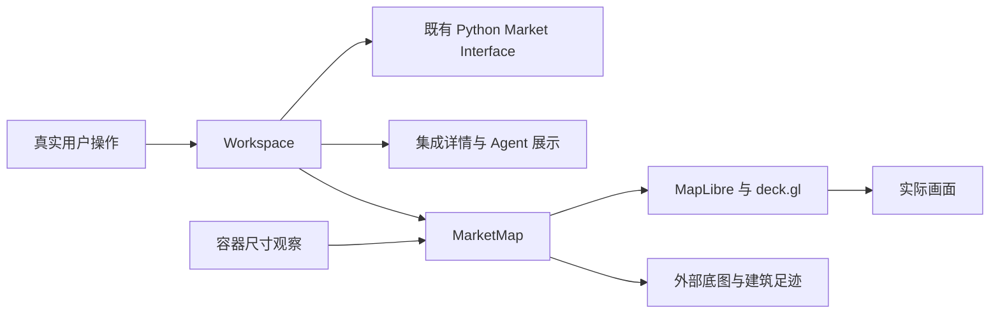
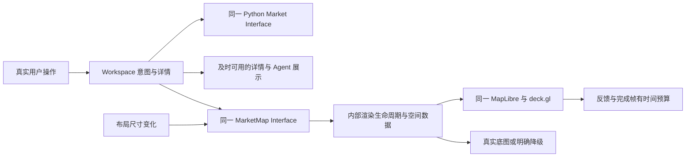
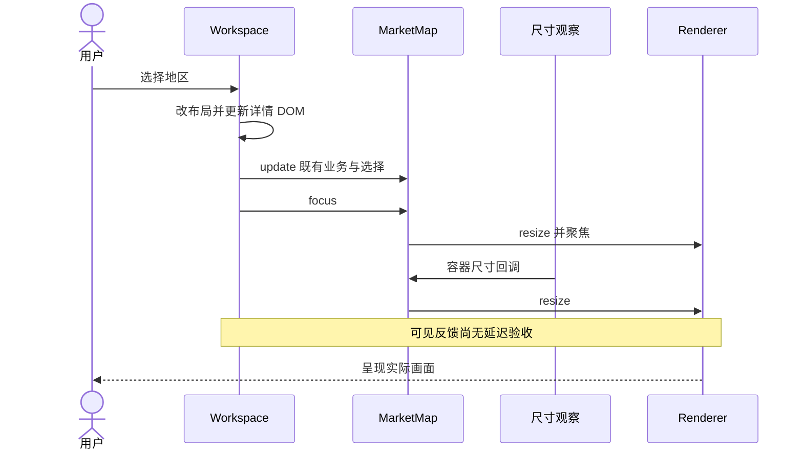
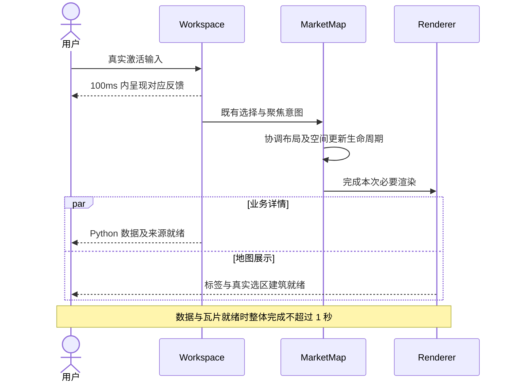
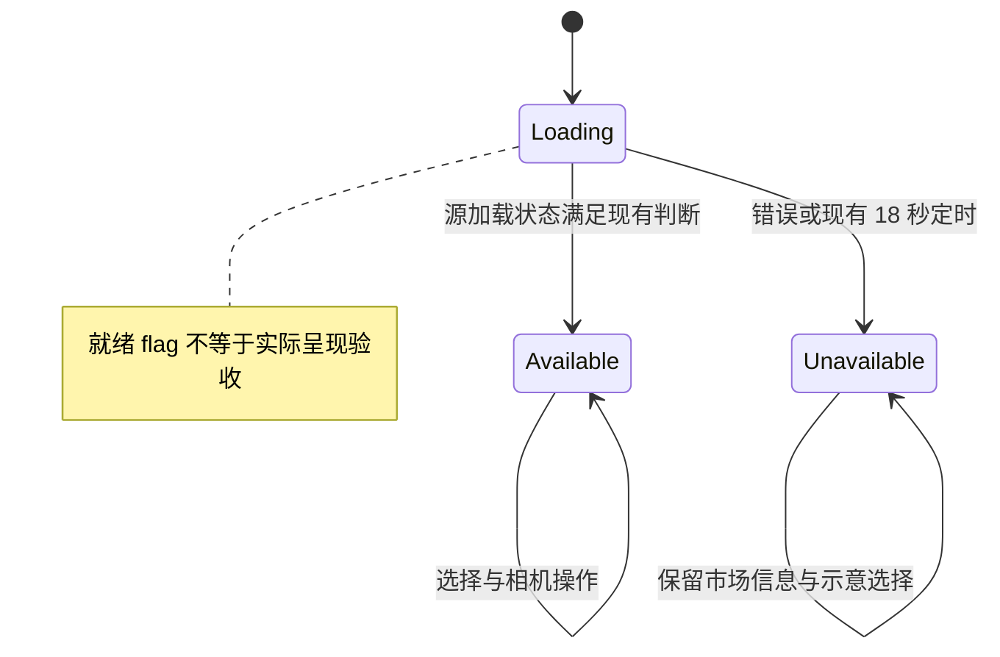
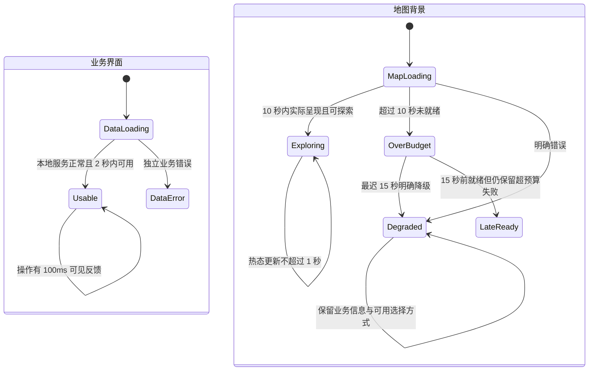
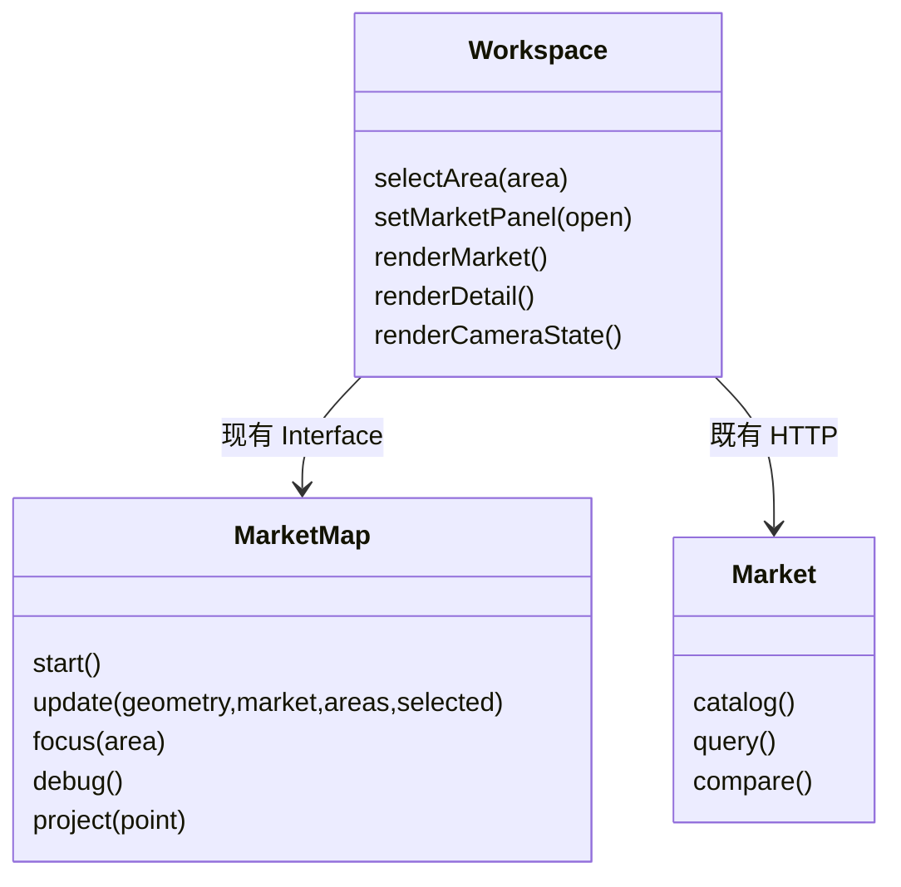
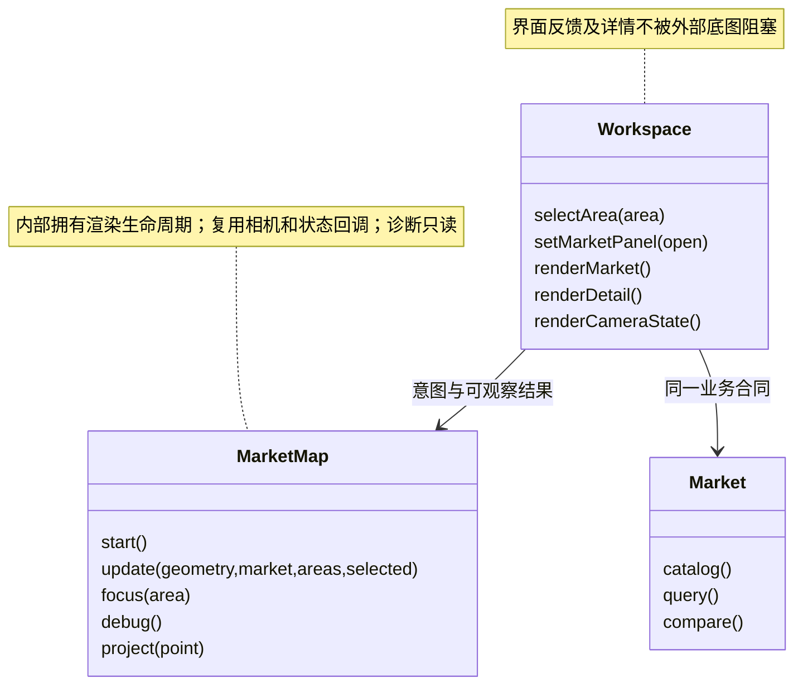

## Problem Statement

当前地图在打开／关闭详情、选择示意区域、相机操作和板块切换时出现长时间等待，浏览器回归也因渲染耗时超限而失败。用户无法迅速确认操作是否生效，开发者难以通过短反馈循环修改代码；继续增加地区搜索和 AI 标注会放大这一风险。

已有测量把画布 resize 与 GPU buffer 分配列为优先调查方向，尚未证明具体根因或修复。问题不是“测试等得不够久”，也不能仅凭模块数量或一次测试通过判定架构和性能合格。

本 spec 是已确认性能要求的父级 spec，关联既有交付 issue #1；不是可直接实现的 Ticket；本次获用户批准将既有三条子票原地转为 Ralph-ready，父 spec 本身不进入执行 backlog。现有实现已保存为 main 上的性能基线，性能验收通过前暂停新增地图／地区功能。

## Solution

为真实用户体验和项目专用测试反馈建立两套独立、必须同时满足的性能门槛。先复现并定位当前慢路径，再以最小改动恢复快速反馈；保留真实 3D 空间背景、集成详情、选择染色、市场证据和独立 Agent 行为。

### 已确认的验收预算

| 基准 | 场景 | 上限 |
|---|---|---:|
| 用户浏览器 | 点击导航／选区后有可见反馈 | 100ms |
| 用户浏览器，热态 | 所需市场数据和地图瓦片已就绪，详情与选区／建筑高亮完成 | 1 秒 |
| 用户浏览器，冷启动 | 界面和本地市场数据可用 | 2 秒 |
| 用户浏览器，冷启动 | 首次真实 3D 底图可探索 | 10 秒 |
| 用户浏览器，底图异常 | 底图仍未就绪时明确降级，业务操作不阻塞 | 15 秒 |
| 专用测试环境 | 快速业务／状态测试及类型检查 | 10 秒 |
| 专用测试环境 | 针对当前改动的一轮聚焦回归 | 30 秒 |
| 专用测试环境 | 完整无模型回归，含真实地图浏览器验证 | 60 秒 |

完整回归已按用户最新确认从原 3 分钟收紧为 60 秒；这是上限，不是固定等待时间。普通编辑只跑最短必要验证，完整层用于阶段收尾。三个既有 Tickets 保留，不增加性能框架或重建 backlog。

这些是待验证的门槛，不是当前已通过的声明。冷启动不能被热缓存结果替代；用户浏览器结果不能由 SwiftShader 测试结果替代，反之亦然。底图超过 10 秒未可探索即未通过首次底图门槛，15 秒降级不将该失败改判为通过。

## User Stories

1. As a 地图使用者, I want 点击导航后在 100ms 内看到反馈, so that 我知道操作已经被接收。
2. As a 地图使用者, I want 点击真实地图选区后立即看到选择反馈, so that 我不必重复点击或猜测系统是否卡住。
3. As a 地图使用者, I want 数据和瓦片就绪时在 1 秒内看到完整详情与高亮, so that 我能快速比较子市场。
4. As a 地图使用者, I want 已选区内及相交的真实建筑足迹部分同步着色且原选区恢复原色, so that 我能看清当前选择而不误染范围外建筑。
5. As a 地图使用者, I want 黄色只表示当前选择, so that 我不会把颜色当作市场数值、来源质量或数据覆盖。
6. As a 地图使用者, I want 第一次打开时在 2 秒内使用界面和本地市场数据, so that 外部底图不会拖住业务信息。
7. As a 地图使用者, I want 首次真实底图在 10 秒内可探索, so that 我可以迅速理解空间位置。
8. As a 地图使用者, I want 底图失败或迟迟未就绪时获得明确降级提示, so that 我知道缺少的是背景服务而不是市场数据。
9. As a 地图使用者, I want 降级后仍能选择地区并读取真实市场信息, so that 地图故障不阻断分析。
10. As a 地图使用者, I want 缩放、平移、旋转、俯仰与复位保持可操作, so that 颜色优化不会牺牲实际地图能力。
11. As a 地图使用者, I want 指标和时期切换保留镜头且显示正确证据, so that 我能在同一空间视图中理解变化。
12. As a 地图使用者, I want 打开或关闭集成详情后画布、拾取和标签保持对齐, so that 布局变化不会造成误选。
13. As a 键盘与触屏使用者, I want 保留现有 focus、Escape、触屏导航和滚动行为, so that 快速体验不限于鼠标桌面。
14. As a 小屏使用者, I want 地图与详情继续可读且无横向溢出, so that 性能修复不破坏窄屏布局。
15. As a 市场分析者, I want 缺失、冲突、Not connected 和服务错误分别展示, so that 速度提升不会以伪造数值或混淆状态为代价。
16. As an Agent 使用者, I want 地图操作不自动发送模型请求或改写已返回回答范围, so that 选择与证据查询保持独立。
17. As a 开发者, I want 快速业务／状态测试及类型检查在 10 秒内返回结果, so that 我能及时验证普通修改。
18. As a 开发者, I want 聚焦回归在 30 秒内完成, so that 我能进行真实 RED／GREEN 循环而不反复等待全套测试。
19. As a 开发者, I want 完整无模型回归在 60 秒内完成, so that 收尾验证及时且保留真实地图覆盖。
20. As a 开发者, I want 遇到超预算时获得最小复现和定向 profile, so that 我能验证原因而不是盲目更换渲染方案。
21. As a 维护者, I want 调用方只表达地区选择、展示和相机意图, so that 渲染生命周期的修改集中在地图 Module。
22. As a 维护者, I want 保留输入、失败、全部测量和运行环境, so that 性能结论可复查而不是挑选最快一遍。
23. As a 维护者, I want 验证结果区分离线业务、真实地图融合和实时模型实测, so that fixture 或历史重放不冒充新的模型验收。
24. As a 维护者, I want 性能退化阻断继续扩展功能, so that 后续地区解析和 AI 标注建立在稳定且可测的基础上。

## Implementation Decisions

1. **先性能、后扩展。** 本轮只规定既有地图性能、测试反馈和降级合同；先关闭已观察的慢路径，不顺手实现新地区检索、标注工具或研究流程。
2. **保持深 Module 的知识归属。** 地图 Module 拥有画布尺寸同步、真实地图手势、空间背景读取、选择几何关系、标签与建筑着色及渲染生命周期。Workspace 拥有导航／详情布局、当前选择、数据展示和回答范围协调；不要求调用方知道瓦片拆分、GPU buffer 或 resize 调用顺序。
3. **复用现有 Interface。** 地图继续接受既有选择、几何、市场结果及相机意图；正常相机展示优先消费已有只读相机回调。诊断不能成为普通 UI 的高成本轮询路径。不得仅为测试公开选择 setter、GPU 参数或内部缓存。
4. **不预选渲染修复。** 重复尺寸同步、整批建筑数据更新和软件渲染影响是可证伪假设；先对真实慢路径测量，一次改变一个变量，再决定最小修复。缓存、合并更新、着色方式或调用时序仅在证据支持时修改，不强制采用新框架、通用调度器或第二地图 Adapter。
5. **界面与底图解耦就绪。** 本地市场查询和可操作界面不等待外部底图完成。地图 Module 拥有加载／可用／不可用状态及降级截止；在该生命周期中保证界面不被长时间同步渲染拖住。
6. **维持真实交互。** 集成详情仍占用真实布局空间，尺寸变化后投影、拾取与可见画布一致；保留九图标导航、独立 Agent 胶囊、地图手势和相机控件。不能靠关闭 3D、覆盖截图、失去真实拾取或强制提前降级来换取正常场景达标。
7. **维持颜色与空间语义。** 橙黄色表示当前示意选择区域，与 available／missing／conflict 独立。真实建筑足迹部分按与该区域相交关系着色，切换选择时恢复；底图合并 MultiPolygon 不得连带染色无关部分。保留地图提供的几何和高度属性，不制造楼栋、物业身份或建筑级市场指标。
8. **维持业务合同。** Market Module 继续拥有数值、比较、时期、单位、缺失与冲突；地图选择不改写提交过的问题／上下文或返回事实的范围。没有新增 endpoint、业务工具、业务 schema、数据源、持久化或认证权限。
9. **降级不伪装。** 底图错误或 15 秒仍未就绪时明确提示；WebGL 可用时保留真实市场信息及示意选择几何。WebGL 不可用时保留地区列表和市场信息并说明不能渲染，不承诺不存在的交互地图。Market Interface 错误不能伪装成覆盖缺失或底图故障。
10. **超预算先调查。** 捕获症状后先保留原始失败与真实输入，建立最小复现、排序假设并做定向 profile，再继续修改；修复前建立捕获症状的回归，阶段收尾再验证原始完整场景，不每次编辑都跑全套。必要覆盖可重新组织或去除重复，但不能删掉功能覆盖、提高超时门槛或用假地图让结果变绿。

## Testing Decisions

### 已由用户确认的测试 Seam

- **主验收 Seam：既有真实应用 UI。** 以 Playwright 驱动真实鼠标、键盘、触屏和首次导航，通过同一 Python HTTP 观察详情、选择、WebGL 建筑、投影及加载／降级结果。
- **快速业务 Seam：已有 Market Interface。** 继续通过其公开入口验证真实历史快照、比较、缺失和冲突；类型检查属于快速反馈层。
- 复用只读地图 state／projection 诊断辅助定位，不注入选区、不调用私有更新方法代替交互、不以单独的 DOM 色块证明建筑着色。不新增生产 Seam。

### 测量口径

1. 两套基准各自固定并记录机器、浏览器版本、GPU／renderer、视窗、DPR、数据、构建版本及依赖状态。用户侧使用本项目专用浏览器、生产构建和实际用户渲染模式；软件渲染测试单独记录为 SwiftShader，不能冒称硬件 GPU。首期至少覆盖桌面 1600×1000 和窄屏 390×844；不据此宣称跨平台或所有硬件达标。
2. 点击／触屏计时从浏览器收到真实激活输入开始，不从事件处理器迟到的开始时间算；结束于首次实际呈现对应选择、导航或加载反馈的帧。DOM 被修改、handler 返回、单次 rAF、debug flag 或 Playwright click 返回本身不足以证明可见反馈。
3. 热态计时从同一真实输入开始，结束于对应详情、标签、选区和真实建筑颜色已呈现且不再是旧选择。包含布局同步与既有聚焦动画；所需市场数据及目标视图瓦片须事先确认已就绪，否则另记为非热态，不丢弃其等待记录。
4. 冷启动三项时限均从首次 navigationStart 算；使用新的项目测试上下文，明确记录缓存状态。2 秒要求本地服务正常时真实市场数据和可操作界面可用；错误／占位文本不算数据就绪。10 秒要求真实空间背景呈现并可探索，不是收到样式响应或仅设置 available。15 秒是从同一次首次导航起算的异常降级截止。
5. 时间作为约定场景的逐次上限判断，保留所有结果，不用平均值、最快一次或成功重试掩盖超限。同一性能场景以固定输入至少独立测三次，每次都须达标；这不要求每次编辑都运行三次完整回归。正常动画与 reduced-motion 各自标明，不用强制禁用动画的结果替代正常体验。
6. 快速、聚焦和完整测试均从命令启动计至退出，包含该命令所需的构建／服务器／浏览器启动及失败证据收集，不只累加 test body。已安装依赖和浏览器；下载／安装不计入预算。完整无模型回归包含业务和浏览器必要覆盖，不将真实地图融合移到未计时的额外套件。
7. 性能验收不得自动重试转绿；已有功能测试重试必须保留首次结果并计入总时间，不能覆盖性能失败。测量若无法可靠对应实际呈现帧，应明确记录证据／Seam 不足而非宣布通过。
8. 测量以只读浏览器／平台探针和 trace 为主；避免高频全画布截图或昂贵 debug 查询污染计时。截图用于绑定真实几何与颜色的正确性证据，profile 用于解释原因；两者都不能单独代替延迟验收。

### 必要回归与测试先例

- 快速层保护 Market 的口径、计算、missing／conflict／错误区别及类型合同；现有 Python 查询与来源测试是先例。
- 聚焦层选择本次修改所影响的最短真实 UI 场景，覆盖首次点击、重复同尺寸操作、真实详情开关尺寸变化、选择切换、筛选不重置相机。现有 `left-detail`、`map-explorer`、`vision-sidebar` 与 `glass-ui` 浏览器行为是先例；不把这些名称当永久文件组织要求。
- 真实地图融合必须检验选区内建筑着色、范围外样本不被误染、原选区恢复；同时验证真实 GPU 拾取和可见投影，不只证明某个 layer 存在。低于既有 3D 显示尺度不要求不存在的建筑体量。
- 完整层保留九导航板块、来源／图表、缺失／冲突、Not connected、底图失败、移动布局、实际手势与相机复位及明确标记的历史 Agent 重放。纯逻辑可用测试 fixture，但 fixture 不进入正式快照、不代替真实地图融合或实时模型实测。
- 本轮禁止新模型调用；启动禁用 Agent 的独立项目服务器，必要的生产浏览器验证在导航前拦截 chat。不连接个人浏览器或其他项目进程。
- 验证分别报告离线业务、真实地图融合／端到端、实时模型实测；最后一项本轮为“未执行”，不能用 replay 或旧证据改写。用户视觉验收与原独立 Closure 仍单独保留。

## Mermaid Gate

**需要图。** 整体修改涉及界面／底图的主要就绪流程、渲染生命周期和降级状态，以及既有 Interface 的性能合同。以下八图为跨 Ticket 的当前／目标设计，不替代每个后续 Ticket 的局部 Mermaid Gate。

“当前”是本次已读取并测量、随后保存为代码基线 `52d205ad700a6940dfee015a21c2795a27d8d29c` 的实现，不是历史交付 spec 的初始 fixed point；“目标”保留外部 Interface、只规定知识归属与可观察时序，不提前选择缓存或着色算法。类图的 Workspace 表示现有页面函数集合这个逻辑 Module，并不要求新增 TypeScript class。

### 架构／调用关系：当前

### 架构／调用关系：目标

### 时序：当前

### 时序：目标

### 状态：当前

### 状态：目标

### 类图：当前

### 类图：目标

## Out of Scope

- 任意地名／地址检索、别名目录扩充、权威 GIS 范围、建筑级物业身份或市场观察。
- AI 自动标注、修改允许工具、研究／发布流程、SDK／认证／持久化合同与新实时模型调用。
- 新依赖、地图框架替换、付费地图、通用插件／调度器和无证据的大范围重构。
- 将示意选择范围称为报告边界；估算高度或市场值；把 missing／conflict／Not connected 变为零或假趋势。
- 宣称跨平台、所有硬件或全互联网网络条件都达标；地图故障、缓存和 renderer 状态必须如实记录。
- 刷新旧 PPT／PDF／ZIP、上传／分享交付包，或未经授权提交／推送和冻结实施 Git 基线；本次已获用户批准的 main 基线保存除外，不因此扩大业务范围。
- 自动拆分 Tickets、启动 Ralph、批量创建 backlog，或将本父 spec 标记 `ready-for-agent`。
- 操作其他项目的浏览器、进程、数据库，或读取／复制个人认证与 Codex 配置。

## Further Notes

### 当前证据与限制

- 最近完整浏览器运行是 26 项：24 通过、2 超时，总计约 5.9 分钟；之后最新渲染 WIP 没有完成全量复验，不能将该结果当作最新性能或产品验收。
- 最近两项原始长场景的聚焦运行仍失败，相机约 49.2 秒、板块约 39.5 秒。完整流程、最小反馈循环和当前代码版本均须在实施阶段重新绑定并验证。
- 一次生产构建的 SwiftShader profile 中，`_resizeCanvas` 累积 self time 约 16.7 秒，两处 `bufferData` 合计约 9 秒，`updateSelectedBuildings` 约 0.09 秒。这是该输入序列的采样结果，不是单次交互延迟、确定根因或硬件 GPU 用户验收。
- 本地证据保留在 `artifacts/left-detail/cpu-profile-summary.json`、`cpu-profile.json`、`e2e.log` 与 `camera-navigation-native-parts.log`；原失败 traces 和截图保留。输入包含 1600×1000、真实底图、按顺序打开／关闭 Macro、Rents、Vacancy。没有新模型请求。
- 原 WIP 所在 HEAD `9b1859ea1de0dba0cb4e3033da4b496459d80242` 不包含后来修改。用户现已批准在 main 提交／推送：相关实现与测试保存为代码基线 `52d205ad700a6940dfee015a21c2795a27d8d29c`，初始化文档随后单独保存。已知浏览器失败仍保留；用户现已批准将既有 #3／#4／#5 原地转为 Ralph-ready，按正文最后的 Git 契约冻结 main 基线；转换须验证 worktree、完整正文与 ready 状态，不代表性能验收或启动循环的授权。

### 文档与审查纪律

- 保持同一份 `GLOSSARY.md` 和既有证据／运行时 ADR；本 spec 不修改子市场、空间背景、示意选择区域或证据定义。
- 代码库已有业务 Interface 与真实浏览器 Seam 足够承载本轮验收，不建立性能 HTTP endpoint、选择注入工具或第二运行时。
- 已完成 spec 终审：应用 codebase-design-lqy、GitNexus 和 simple 核对知识归属、依赖方向、既有合同、覆盖与预算，保留最小范围和已确认门槛；澄清三次性能采样不等于每次编辑三次全套回归。GitNexus 1.6.9 在当前工作区正常建立本地索引，selectArea／MarketMap／Market.query 的关系与源码交叉核对，没有新增生产 Seam。未启动 review agent，不冒充原独立 Closure。
- 八张图已通过 GitHub 官方 Mermaid renderer 实际解析／生成 SVG；复用本项目公开 issue 页面和独立浏览器，未安装新依赖或写入既有 issue。图与 spec 的验证不代表产品性能已达标。
- GitHub Issues 是唯一 tracker；本地 spec 文档是正文镜像，不是另一份 Ticket／状态／依赖清单。三条已批准 Tickets 为 #3（热态交互）、#4（冷启动／降级）、#5（验证反馈），#5 依赖 #3、#4；局部 Gate 和最新 60 秒预算已发布。不重复创建 Tickets，实施或 Ralph 启动仍需明确授权。
- 编码 Agent 默认具有完整开发工具权限，不继承应用市场 Agent 的六工具只读限制；当前任务的业务范围和新依赖／合同／付费／发布授权要求不因此扩大。初始化入口为根 `AGENTS.md` 与 `README.md`，已知失败和实际验收状态见 `docs/verification.md`。

## Git

- Branch: `main`
- Base branch: `origin/main`
- Base commit: `af77db4c7b55140f9c4a4ee3662f98f8fcc2cc4a`
